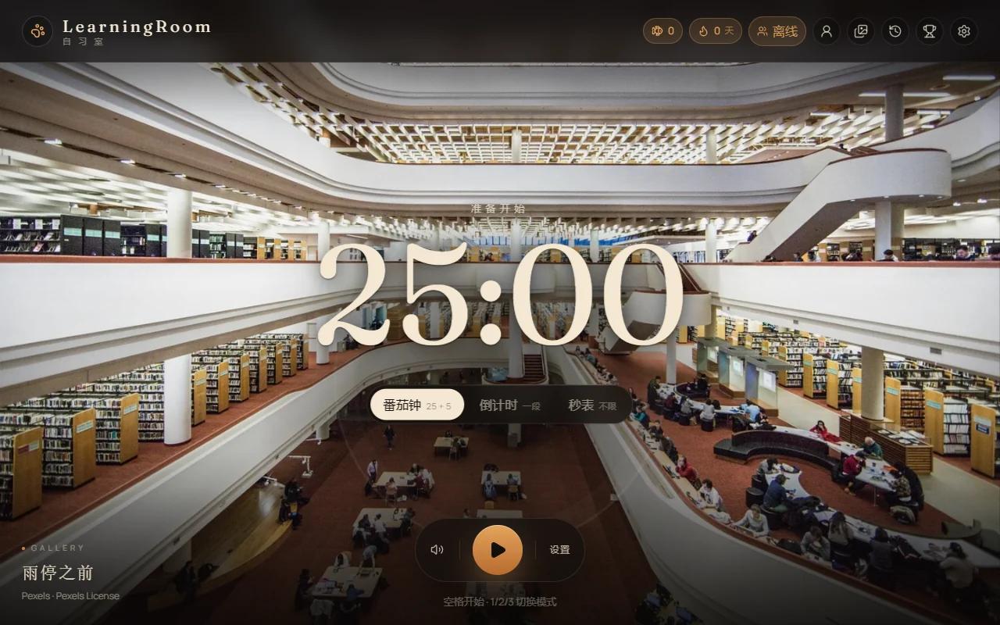
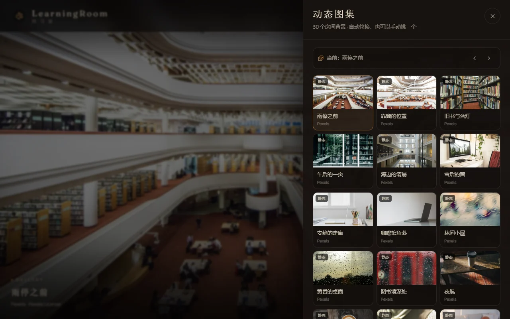
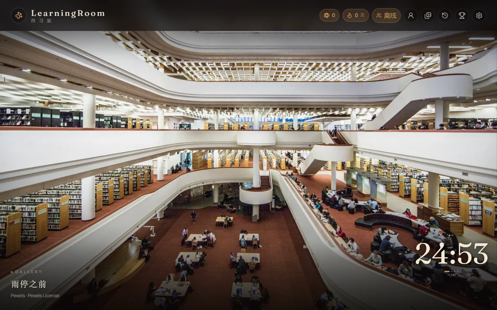
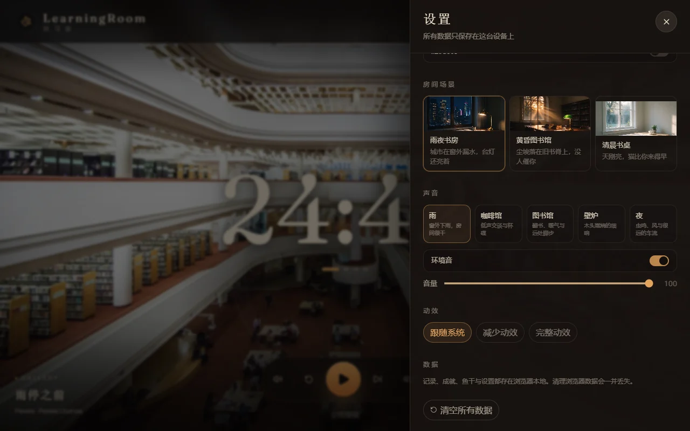

# LearningRoom · 自习室

> 选一个地方，调好声音，让时间变得有意义。

这是 `feat/stillwhere-study-room` 分支：**纯自习室**。监督机制不在此分支开发，保留在 `main`。



## 这个分支有什么

- **30 项动态图集**：20 张 Pexels 免费静图 + 5 段 Pexels 免费视频 + 5 段作者提供的美丽风景视频。默认 10 分钟自动轮换，可手动切换、随机、关闭。
- **计时器下沉**：开始后 700ms 平滑缩到右下角；暂停或结束回到中央。右下角点击即可暂停并展开。
- **5 套环境音**：雨、咖啡馆、图书馆、壁炉、夜；CC0 素材，crossfade、音量、开关，刷新后保留。
- **账户系统**：游客优先；邮箱密码注册/验证/登录/找回/改密/删除/导出；登录后同步设置与专注记录。
- **在线人数**：Durable Object WebSocket 统计在线/专注人数；交流区消息流本期**未实现**，只留占位与 TODO。
- **纯自习模式**：没有猫、巡查、扣星；计时、记录、成就、历史照常。

| 图集 | 计时器收缩 |
| --- | --- |
|  |  |

| 设置 | 房间场景 |
| --- | --- |
|  | 图集/房间可切换 |

## 技术栈

**前端**：Vite 7 + React 19 + TypeScript + Tailwind 4 + Zustand + PWA；继续部署 GitHub Pages。

**后端**：Cloudflare Workers + Hono + D1 + R2 + Durable Objects + Resend。

| 层 | 选型 |
| --- | --- |
| API | `https://api.learningroom.dpdns.org` |
| 媒体 | `https://media.learningroom.dpdns.org`（R2 自定义域） |
| 数据库 | D1（用户、会话、同步、记录、限流） |
| 在线人数 | Durable Object `PresenceRoom`（WebSocket + 快照） |
| 邮件 | Resend（验证/重置） |
| 前端托管 | GitHub Pages + 自定义域名 |

## 快速开始

### 前端

```bash
npm install
npm run dev
```

默认构建无 API 时仍可本地自习，账号/在线人数会降级。

### 后端

```bash
cd server
npm install
npx wrangler login
npx wrangler d1 create learningroom-db
npx wrangler r2 bucket create learningroom-media
# 把 d1 id 填进 server/wrangler.toml
npx wrangler d1 migrations apply learningroom-db --remote
npx wrangler secret put PASSWORD_PEPPER
npx wrangler secret put RESEND_API_KEY
npm run deploy
```

前端构建时注入：

```text
VITE_API_BASE=https://api.learningroom.dpdns.org
VITE_MEDIA_BASE=https://media.learningroom.dpdns.org
```

完整步骤、API、隐私与安全说明见 [server/README.md](server/README.md)。

## 本地验证

```bash
npm run verify        # lint + 前端 85 个测试 + build
npm run worker:typecheck
npm run worker:test   # 需要 workerd 可正常启动
```

## 图集与音频

- 静态图：`public/gallery/images/01.webp … 20.webp`
- 视频 poster：`public/gallery/posters/`
- 视频成品：`public/gallery/videos/`（5 段 Pexels + 5 段作者提供）；可选迁到 R2，设置 `VITE_MEDIA_BASE` 即可
- 音频：`public/audio/ambience/{cafe,library,fireplace,night}.m4a` + 现有雨声
- 处理/上传：`scripts/prepare-gallery.py`、`scripts/upload-gallery.mjs`

## 当前待办

- [x] 5 段作者动态壁纸已接入（`public/gallery/videos/user-01 … 05.mp4`）
- [ ] **TODO(cloudflare)**：D1/R2/DO/Resend 实际部署（需要账号登录与密钥；当前视频随仓库发布，不依赖 R2）
- [ ] 交流区消息流（单房间、登录发言、200 字、限流、举报）——本期只做在线人数，代码留 TODO
- [ ] 线上手工验收：注册→验证→登录→同步；两标签页在线人数
- [ ] 移动端 390×844 适配复查

## 与 main 的关系

- `main` 仍是有耄耋监督的版本。
- 本分支通过 `PURE_STUDY_ROOM=true` 隐藏监督入口，不修改监督核心代码。
- 合并回 `main` 前需要决定保留哪些 UI、是否把纯模式作为开关而不是分支默认。

## 文档

- [交接文档（main 版）](docs/HANDOFF.md)
- [后端说明](server/README.md)
- [素材与许可](ASSETS.md)
- [图集/音频处理](scripts/prepare-gallery.py)
