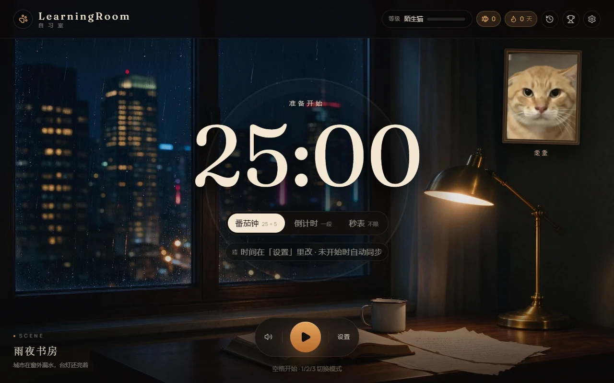
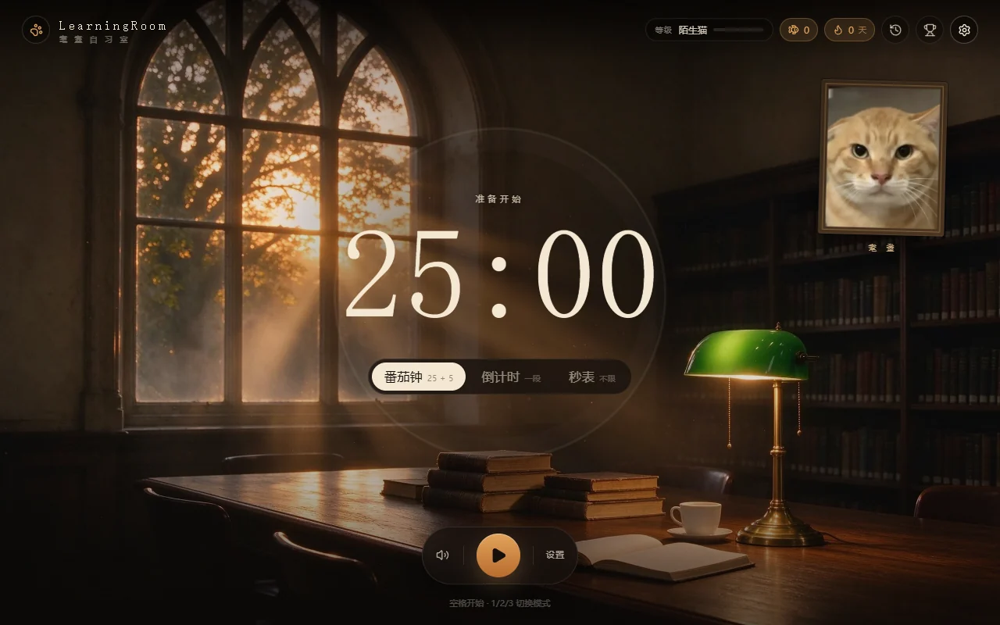
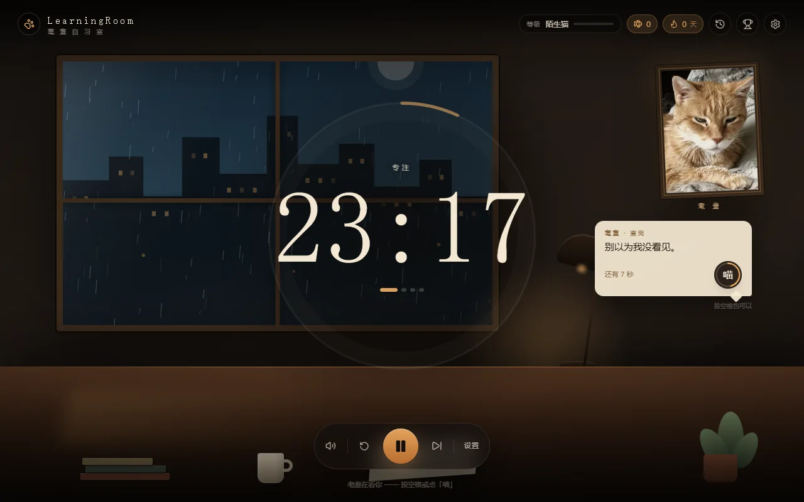
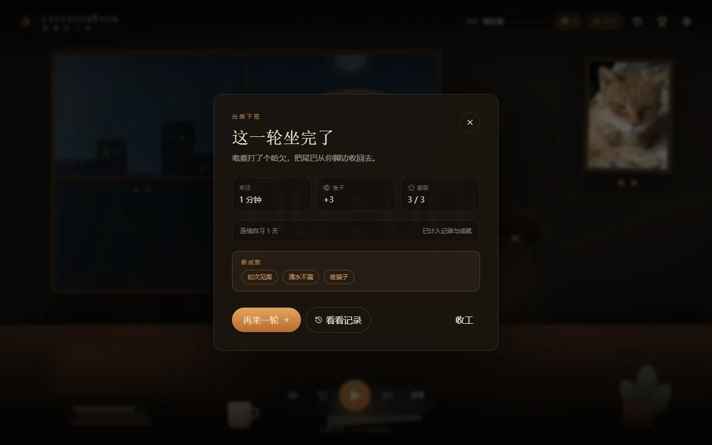
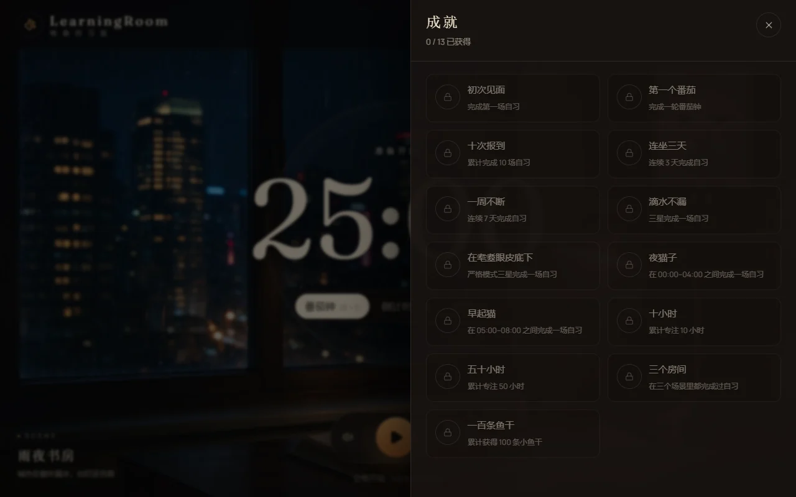
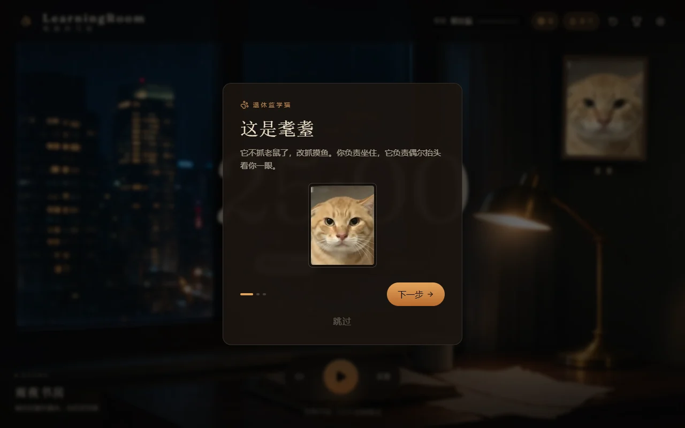
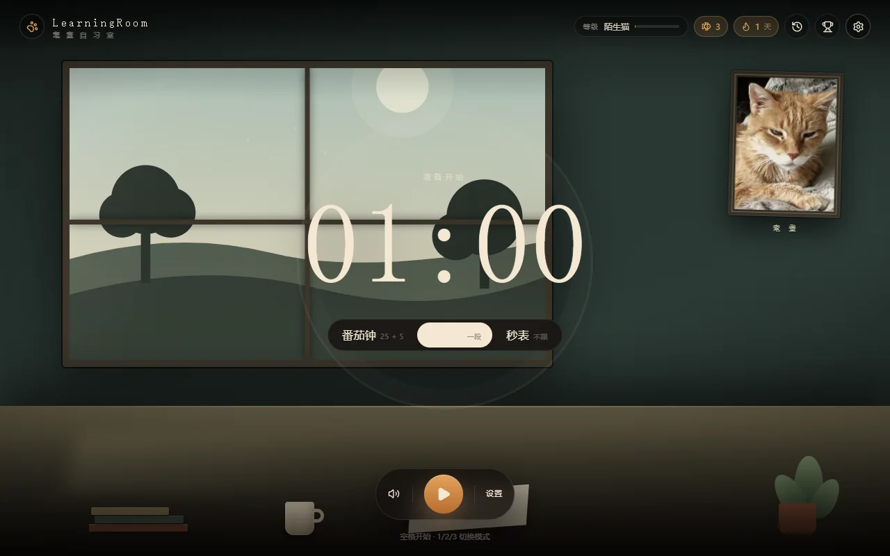
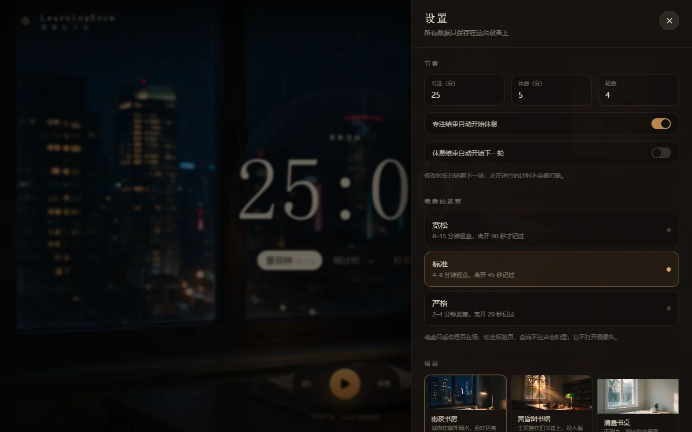
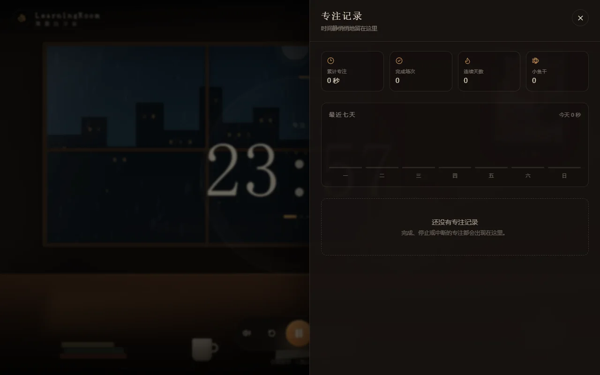

# LearningRoom · 耄耋自习室

> 一只退休的监学猫，陪你把这一轮坐完。

一个**混合型单人在线自习室**：Stillwhere 式的场景与计时氛围，加一点 Redwatch 式的巡查压力——但监督者换成一只上了年纪的橘猫「耄耋」，而且**不碰摄像头**。

浏览器打开即用，无需登录；记录只保存在本机。



> 截图使用内置 SVG 场景；把 Seedream 生成的 16:9 高清图放进 `public/scenes/`，主界面会自动切换为照片场景（无需改代码）。

## 它是什么

- **场景**：雨夜书房 / 黄昏图书馆 / 清晨书桌。支持 **16:9 高清摄影场景**（放进 `public/scenes/` 自动启用，带淡入与压暗层），缺图时回退到原创 SVG 房间。生成提示词见 [docs/scene-prompts.md](docs/scene-prompts.md)。
- **计时**：番茄钟 / 倒计时 / 秒表，支持自定义时长、轮数、自动开始休息。
- **耄耋巡查**：专注中老猫会不定时查岗，15 秒内按空格或点「喵」；切走标签页超时会扣星。三颗星扣光，这一轮作废。
- **只监督在场**：不打开摄像头，不读屏幕，只看你是否还在、是否应声。
- **成长**：小鱼干、连续天数、5 级「猫的认可」、13 个成就、专注历史与 7 日统计。
- **离线可用**：PWA，可安装到桌面/主屏；断网后第二次打开仍能继续。

| 场景（SVG 回退） | 巡查 |
| --- | --- |
|  |  |

| 完成结算 | 成就 |
| --- | --- |
|  |  |

<details>
<summary>更多截图：引导、清晨书桌、设置、历史</summary>

| 引导 | 清晨书桌 |
| --- | --- |
|  |  |

| 设置 | 历史 |
| --- | --- |
|  |  |

</details>

## 玩法与规则

| 项 | 规则 |
| --- | --- |
| 星级 | 每场 3 颗；离座 / 查岗未应各扣 1 颗；同一类违规 30 秒冷却 |
| 巡查间隔 | 宽松 8–15 分钟 / 标准 4–8 分钟 / 严格 2–4 分钟；首轮固定在 60–120 秒 |
| 离座判定 | 标签页隐藏超过宽限（90 / 45 / 20 秒） |
| 查岗 | 气泡出现后 15 秒内回应，超时扣星 |
| 无操作 | 只触发查岗，不直接扣星（避免「在看书」被误判） |
| 小鱼干 | 完成一场：`floor(专注秒数 / 600) + 剩余星数`；失败 0；主动中止半速 |
| 连续天数 | 只有「完成」的场次计入；业务日按本地时间 **04:00** 切换 |
| 等级 | 0 / 5h / 20h / 50h / 100h → 陌生猫 / 面熟 / 常客 / 猫友 / 耄耋认可 |

更细的状态机、公式与存储结构见 [docs/product.md](docs/product.md)。

## 技术栈

- **Vite 7 + React 19 + TypeScript**
- **Tailwind CSS 4**（`@theme` 设计令牌）
- **Zustand**（三套 store：设置 / 进度 / 会话）
- **vite-plugin-pwa**（离线缓存 + 安装）
- 纯 CSS/SVG/Canvas 场景，无 3D 引擎、无动画库
- 音频：HTMLAudioElement 雨声循环 + Web Audio 提示音
- 测试：Vitest（73 个用例，覆盖计时、巡查、进度、存储）

首屏 JS 约 **95 KB gzip**，总资源约 **1.3 MB**（含猫图、雨声、图标）。

## 本地运行

需要 Node 20.19+ / 22.12+ / 24。

```bash
npm install
npm run dev
```

打开 `http://localhost:5173`。

```bash
npm run test     # 单元测试
npm run lint     # ESLint
npm run build    # 类型检查 + 生产构建
npm run verify   # lint + test + build
```

> Windows + DSH 沙箱里 npm 缓存默认在用户目录，可能 `EPERM`；把缓存指到项目内：
> `$env:npm_config_cache = "$PWD\.npm-cache"`。

## 部署

仓库自带 [`.github/workflows/deploy.yml`](.github/workflows/deploy.yml)：push 到 `main` 后自动跑 `npm run verify`，然后尝试发布到 GitHub Pages。

**首次使用需手动启用一次**：仓库 **Settings → Pages → Source** 选择 **GitHub Actions**。未启用时工作流仍会完成构建（deploy 任务自动跳过），启用后重新运行即可发布。

线上地址：`https://francisco939.github.io/LearningRoom/`

Vite 会根据 `GITHUB_ACTIONS` 自动把 `base` 设为 `/LearningRoom/`。

## 目录

```
src/
  components/
    scene/        场景原语：窗户、雨、桌子、台灯、相框
    timer/        计时显示、进度环、控制条、模式切换
    supervisor/   耄耋相框、气泡、查岗、记过印章
    panels/       历史、成就、设置、引导、结算
    hud/          顶栏
  store/          settings / progress / session
  hooks/          timer engine、supervisor、ambience、hotkeys、reduced motion
  lib/            纯函数：计时状态机、巡查规则、进度/成就、统计、存储、音频
  data/           场景、成就、猫台词、等级
docs/
  product.md      玩法、公式、状态机、存储
  scene-prompts.md  Seedream 高清场景提示词
  research/       两套竞品拆解与品类研究
  screenshots/    README 截图
public/
  scenes/         可选的高清场景图（缺图自动回退 SVG）
  supervisor/     耄耋肖像
  audio/          雨声循环
  icons/          PWA 图标
scripts/          素材处理脚本
```

## 素材与许可

- 代码：[MIT](LICENSE)
- 督学肖像：john gosk，Flickr，**Public Domain Mark 1.0**
- 雨声：seth-m，Freesound `270349`，**CC0 1.0**
- 场景 / 猫脸 SVG / 图标：本项目原创

完整署名、处理方式与备用素材见 [ASSETS.md](ASSETS.md)。

> 「耄耋」是原创致敬角色，灵感来自中文互联网上「上了年纪、脾气不好、眯眼看人」的老橘猫形象。本项目**不使用**真实「圆头猫爹 / 圆头耄耋」的影像，也不包含与虐猫梗相关的内容。设置里可以上传自己的图替换督学形象（只保存在本机）。

## 路线图

- [ ] 云同步与账号（本地数据模型已留出 `Repository` 接缝）
- [ ] 多人「一起自习」房间（SSE / WebSocket）
- [ ] 自定义场景包与音频包
- [ ] 更细的统计与周报
- [ ] Windows 桌面悬浮窗

## 研究底稿

这个项目的场景、计时与「轻监督」取舍，来自对两个真实产品的拆解：

- [凛冬督学局（redwatch.top）](docs/research/01-redwatch.md)
- [Stillwhere（stillwhere.app）](docs/research/02-stillwhere.md)
- [在线自习室品类图谱](docs/research/03-landscape.md)
- [LearningRoom 架构建议](docs/research/04-learningroom-proposal.md)
- [高清场景生成提示词](docs/scene-prompts.md)
