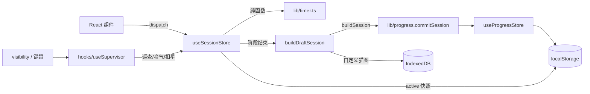

# LearningRoom · 耄耋自习室 — 交接文档

> **版本说明**：本文保留的是历史监督版说明。当前 `main` 与 `feat/stillwhere-study-room`
> 都已是纯自习室版本，功能、后端和待办以 [README](../README.md) 与
> [server/README](../server/README.md) 为准；监督版最后停留在 `17760d6`。
>
> 交接基线：`85360c4`（本交接文档之后的提交以 `git log -1` 为准）。
> 读者：接手的开发者 / 设计师。目标：**30 分钟跑起来，2 小时知道该改哪里**。
> 先读：[README](../README.md) → 本文 → [docs/product.md](product.md)。

---

## 0. 先做这三件事

1. **把项目跑起来**

   ```bash
   git clone https://github.com/francisco939/LearningRoom.git
   cd LearningRoom
   npm install
   npm run verify     # lint + 82 个单测 + tsc + build
   npm run dev
   ```

2. **读产品规则**：[docs/product.md](product.md) 里有计时状态机、巡查规则、鱼干/连续天数公式、存储结构。

3. **确认 GitHub Pages 的 Source 是 GitHub Actions**（2026-11-08 已切换并部署成功）：
   仓库 **Settings → Pages → Build and deployment → Source** 应为 **GitHub Actions**。
   如果误选 `Deploy from a branch`，Pages 会发布仓库根目录的 `index.html`，入口指向 `/src/main.tsx`，线上就是空白页。

---

## 1. 项目坐标

| 项 | 值 |
| --- | --- |
| 仓库 | https://github.com/francisco939/LearningRoom |
| 默认分支 | `main` |
| 线上地址 | `https://www.learningroom.dpdns.org/`（**已部署并验证**，2026-11-08；`github.io/LearningRoom/` 会跳转；首次打开如空白请强刷） |
| CI | `.github/workflows/deploy.yml`（自定义构建/部署）成功；Pages Source 已改为 GitHub Actions，旧的 `pages build and deployment` 不再作为发布源 |
| 代码许可 | MIT（`LICENSE`） |
| 素材许可 | 单独说明，见 [ASSETS.md](../ASSETS.md)；**不全是 MIT** |
| 运行形态 | 纯静态 SPA，无后端、无账号、无云同步 |
| Node | 开发机 v24.19.0；CI 用 Node 24 |
| 包管理 | npm 11（`package-lock.json` 已提交） |

**权限提醒**：Pages 设置、仓库设置、自定义域名都只有仓库 owner（francisco939）能改。接手者如果不是 owner，改 Pages 源/自定义域名需要 owner 协助。

---

## 2. 产品一句话与边界

**一句话**：一个带「退休监学猫」的沉浸式单人自习室。场景 + 计时 + 轻监督，专注中猫会突然从窗边/屏幕边缘探头；不应声或离开页面就张嘴哈气、扣星。

**已做的**：

- 三套 16:9 高清场景（雨夜书房 / 黄昏图书馆 / 清晨书桌）+ SVG 回退
- 番茄钟 / 倒计时 / 秒表；自定义时长、轮数、自动开始
- 耄耋巡查：随机探头、15 秒回应、离座检测、扣星、记过、失败结算
- 帧动画：探头 83 帧、哈气 73 帧，15fps，canvas 播放，末尾停帧
- 成长：鱼干、连续天数、5 级等级、13 个成就、历史与 7 日统计
- 游客可用、PWA 离线、设置里可上传自定义督学图（只存本机）

**明确不做的**：

- 摄像头 / 屏幕采集 / 人脸识别
- 账号、云同步、多人房间、实时聊天
- 付费、排行榜、社交关系链
- 服务端时间权威（当前以本地时钟为准）

这些边界是产品决策，不是半成品。加功能前先确认是否愿意承担隐私/合规/后端成本。

---

## 3. 技术架构

### 3.1 栈

| 层 | 选型 |
| --- | --- |
| 构建 | Vite 7 + React 19 + TypeScript 5.9 |
| 样式 | Tailwind CSS 4（`@theme` 令牌）+ 手写 CSS（场景、动画） |
| 状态 | Zustand 5（3 个 store） |
| 本地存储 | localStorage（设置/进度/记录/运行快照）+ IndexedDB（自定义猫图） |
| PWA | `vite-plugin-pwa`（generateSW，autoUpdate） |
| 字体 | `@fontsource-variable/fraunces` + `manrope`（OFL） |
| 图标 | `lucide-react` |
| 测试 | Vitest 4 + jsdom |

无路由、无 SSR、无 API 层。Vite 使用相对 `base: './'`，同时兼容自定义域名根路径和 `github.io/LearningRoom/` 子路径。

### 3.2 数据流



### 3.3 计时

- 状态机在 [`src/lib/timer.ts`](../src/lib/timer.ts)：`idle → running ⇄ paused → finished`，阶段 `focus → break → … → done`。
- **时间戳驱动**：剩余 = `phaseEndsAt - now`，不做递减计数；后台节流/休眠不漂移。
- 每个 focus 阶段有独立锚点 `focusStartedAt + focusPausedTotalMs`，跨 break 不会把休息算进专注。
- 运行中快照写 `lr.active.v1`，刷新恢复；过点只补一次阶段。
- 结算：`useTimerEngine` 监听 `finished`，`buildDraftSession` → `buildSession` → `useProgress.record`，并用模块级 `Set` 防重复提交。

### 3.4 巡查

- [`src/hooks/useSupervisor.ts`](../src/hooks/useSupervisor.ts)：
  - 首轮巡查 60–120 秒，之后按档位 2–15 分钟；
  - 离座看 `visibilitychange`，超过宽限扣星；
  - 无操作只触发查岗，不直接扣星（避免「在看书」误判）；
  - 页面隐藏时错过的巡查 5 秒后重试；
  - `supervisionEnabled=false` 时整个 hook 停止调度/visibility 监听，并清掉 patrol、peek、stamp；App 同时隐藏猫、气泡、记过和等级条。
  - **StrictMode 首轮巡查**曾因二次 effect 变成 4–8 分钟，已用 `hasPatrolled` ref 修；改这里时别退回 `firstRef` 写法。
- 查岗：`useSession.setPatrol(deadline, anchor)` 同时写入 `peek` 状态；超时/离座调 `showPeek(anchor,'yell')` + `violation()`。
- 帧播放：`PeekVisual` 读取 `peek.json` / `yell.json`，从 sprite sheet 逐帧画到 canvas；最后一帧保持。
- 音效：`ambience.hiss()` 播 `hiss.m4a`（真实猫哈气 CC0），失败才合成；受设置里的「声音」开关控制。

### 3.5 存储

| Key | 内容 |
| --- | --- |
| `lr.settings.v1` | 模式、时长、轮数、监督档、`supervisionEnabled`、`catName`、场景、声音、音量、自定义猫图标记、动效偏好 |
| `lr.progress.v1` | 累计专注、场次、鱼干、连续天数、场景集合、成就、是否看过引导 |
| `lr.sessions.v1` | 最近 1000 场记录 |
| `lr.active.v1` | 运行中 `TimerState` 快照 |

IndexedDB（`idb-keyval`）：`lr-cat-image` 存用户上传的督学图（最长边 720px dataURL）。

**清浏览器数据 = 全部丢失**，目前没有导出入口（README 路线图里有）。

### 3.6 部署

- `push main` → Actions：`npm ci` → `npm run verify` → 检查 Pages 是否启用 → 上传 `dist` 工件 → 若启用则 `deploy-pages`。
- `vite.config.ts`：`base: './'`；`public/CNAME` 会被复制到 `dist/CNAME`，随 artifact 发布。
- 未启用 Pages 时，构建任务仍成功，`deploy` 跳过，并输出 notice。
- **如果 Pages 的 Source 还是 “Deploy from a branch”**，GitHub 会另跑一条 `pages build and deployment`，发布 `main` 根目录；它和自定义 `deploy-pages` 是两条链路，页面最终看到的是 branch 的原始 `index.html`（入口 `/src/main.tsx`），因此空白。必须把 Source 改成 GitHub Actions。
- 自定义域名 `www.learningroom.dpdns.org`；DNS 为 `CNAME www -> francisco939.github.io`；没有环境变量、没有 secrets。

---

## 4. 目录地图：改哪里

| 想改什么 | 文件 |
| --- | --- |
| 计时规则 / 阶段切换 | `src/lib/timer.ts` |
| 巡查间隔 / 宽限 / 查岗时限 | `src/lib/supervision.ts` |
| 第一次巡查时间 | 同上（`FIRST_PATROL_MIN_MS/MAX_MS`） |
| 探头位置（窗/左/右/底） | `src/lib/peek.ts` + `src/index.css` 的 `.peek-*` |
| 探头/哈气帧播放 | `src/components/supervisor/PeekVisual.tsx` |
| 气泡、查岗按钮、哈气文字 | `src/components/supervisor/PeekCat.tsx` |
| 静态贴纸回退 | `public/supervisor/maodie-peek.webp` |
| 相框/墙上肖像 | `src/components/supervisor/PortraitFrame.tsx` |
| 场景图/回退 | `src/data/scenes.ts`、`src/components/scene/*` |
| 鱼干/连续天数/成就 | `src/lib/progress.ts`、`src/lib/stats.ts`、`src/data/achievements.ts` |
| 等级 | `src/data/levels.ts` |
| 猫台词 | `src/data/catLines.ts` |
| 主界面布局 | `src/App.tsx`、`src/index.css` |
| 顶栏 | `src/components/hud/TopBar.tsx` |
| 设置面板 | `src/components/panels/SettingsPanel.tsx` |
| 引导/结算 | `src/components/panels/Onboarding.tsx`、`ResultOverlay.tsx` |
| 素材处理 | `scripts/prepare-assets.py`、`scripts/prepare-video-frames.py` |
| 场景/视频提示词 | `docs/scene-prompts.md`、`docs/video-prompts.md` |

**开发期调试钩子**：仅 DEV 生效的 `window.__lrPeek('patrol'|'yell', anchor)`，用于手动触发探头/哈气，不必等 4–15 分钟。生产构建会被 `import.meta.env.DEV` 剔除。

---

## 5. 本地开发

### 5.1 命令

| 命令 | 作用 |
| --- | --- |
| `npm run dev` | Vite 开发服务器（默认 5173） |
| `npm run build` | `tsc --noEmit && vite build` |
| `npm run preview` | 预览生产构建 |
| `npm run lint` | ESLint 9（含 react-hooks 严格规则） |
| `npm run test` | Vitest（7 个文件，82 个用例） |
| `npm run verify` | lint + test + build，提交前必跑 |

### 5.2 Windows / DSH 沙箱的坑（重要）

这台机器的环境不是标准 Windows，下面几条能省几小时：

1. **npm 缓存会 EPERM**：默认缓存在 `C:\Users\...\AppData\Local\npm-cache`，沙箱可能拒绝。
   ```powershell
   $env:npm_config_cache = "$PWD\.npm-cache"
   npm install
   ```

2. **Vite / Vitest 会因 esbuild 子进程 EPERM**：沙箱禁止带管道的子进程。需要让命令以 `danger-full-access` 运行，或直接在有正常权限的终端跑。

3. **git HTTPS 会 schannel 失败**：`SEC_E_NO_CREDENTIALS`。仓库级配置：
   ```powershell
   git config http.sslBackend openssl
   ```
   推送时如果凭据管理器弹窗，设置 `GCM_INTERACTIVE=never` / `GIT_TERMINAL_PROMPT=0`。

4. **编辑器原子写入会留下 `*.tmpdir`**：Vite watcher 已忽略 `**/*.tmpdir/**`；如果看到 `EBUSY ... tmpdir`，删掉这些目录并重启 dev。

5. **`.pydeps` / `.models` 权限受限**：它们只用于一次性抠像（rembg），已 gitignore。普通开发不需要；想清磁盘可以直接删。

6. **不要提交**：`node_modules/`、`dist/`、`.npm-cache/`、`assets-src/`、`.pydeps/`、`.models/`、`.tmp/`、`.pip-cache/`。

### 5.3 端口/环境

- 无 `.env`、无后端地址；所有 API 都是本地静态资源。
- `npm run dev` 端口被占用时 Vite 会自动换端口（曾出现 5174）。
- 生产与本地都使用相对 `base: './'`；页面在根路径或 `/LearningRoom/` 子路径下都能正确解析资源。

---

## 6. 测试与验收

### 6.1 自动化

```
src/test/timer.test.ts         33 例：启动/暂停/恢复/跳过/违规/中止/秒表/刷新恢复/跨轮累计
src/test/supervision.test.ts   11 例：三档配置、首轮区间、宽限边界、冷却
src/test/progress.test.ts      23 例：鱼干公式、04:00 切日、连续天数、13 个成就
src/test/session.test.ts        7 例：buildDraftSession 状态/时长映射
src/test/settings.test.ts       4 例：catName / supervisionEnabled 迁移与边界
src/test/portrait.test.tsx      2 例：相框名字显示与空值回退
src/test/timerHint.test.tsx     2 例：10 秒自动关闭、点击关闭并打开设置
```

**没覆盖的**：React hooks（`useSupervisor` / `useTimerEngine`）、帧播放、音频、PWA、真实浏览器布局、移动端。改巡查 hook 时请补测试或至少手工跑清单。

### 6.2 手工清单（每次改核心逻辑跑一遍）

- [ ] 番茄钟 1 分钟：开始 → 暂停 → 恢复 → 到点 → 结算
- [ ] 切到后台 50 秒回来：标准档扣 1 星
- [ ] 触发巡查不应声：15 秒后哈气、扣星、记过印章
- [ ] 三颗星扣光：进入「被赶出自习室」结算
- [ ] 刷新：运行中计时恢复；暂停状态恢复后仍暂停
- [ ] 设置改场景/时长/声音，刷新后仍生效
- [ ] 上传自定义猫图 → 刷新仍在；恢复默认正常
- [ ] 清空数据有二次确认
- [ ] 断网后二次打开（PWA）可用

### 6.3 CI

`npm run verify` 在 GitHub Actions 的 Ubuntu + Node 24 上跑；通过后才会考虑部署。当前自定义 workflow 全绿；另有 GitHub 的 `pages build and deployment`（branch 模式）也会绿，但它发布的是仓库根目录，不代表构建产物可用——看线上是否空白，先查入口脚本。

---

## 7. 资产管线

> 所有二进制素材的许可、作者、处理方式以 [ASSETS.md](../ASSETS.md) 为准；下面是操作层面。

### 7.1 高清场景（3 张）

`public/scenes/{rainy-study,dusk-library,dawn-desk}.webp`，2560×1440，16:9，单张 184–224KB。

- 由项目作者用 Seedream 生成，提示词在 [docs/scene-prompts.md](scene-prompts.md)。
- 已裁掉右下角「豆包 AI 生成」水印（右侧 240px、底部 133px 后统一到 16:9）。
- 运行时 `` 加载，失败自动回退到 `src/components/scene/*` 的 SVG 房间。
- 换图：保持文件名和 16:9 即可，不用改代码。
- 构图约定：右侧 30% 留安静墙面给相框；中下部留给计时器/控制条。

### 7.2 督学肖像与贴纸

- `public/supervisor/maodie.webp`：720×900（4:5），**作者提供的豆包 AI 生成图**，裁掉字幕/水印。不是 MIT，不能单独再授权。
- `public/supervisor/maodie-peek.webp`：620×513 透明贴纸，rembg 去背景 + 奶油描边 + 底部渐隐，是帧动画加载失败时的回退。
- 设置 → 督学形象可让用户上传自己的图，存 IndexedDB（`lr-cat-image`），不会进仓库。
- **不要**使用真实「圆头猫爹 / 圆头耄耋」影像；该梗有版权与虐猫争议。

### 7.3 巡查帧动画（重点）

源视频（**不提交**，放 `assets-src/video/`）：

- `peek-src.mp4`：720×720，10s，H.264 + AAC，绿幕
- `yell-src.mp4`：同上

成品（提交）：

| 文件 | 内容 | 规格 |
| --- | --- | --- |
| `public/supervisor/peek-sheet.webp` | 83 帧 | 15fps，单帧 280×280，10×9 网格，413KB |
| `public/supervisor/peek.json` | `{fps:15, cell:280, cols:10, rows:9, count:83}` | |
| `public/supervisor/yell-sheet.webp` | 73 帧 | 15fps，单帧 280×280，10×8 网格，557KB |
| `public/supervisor/yell.json` | `{fps:15, cell:280, cols:10, rows:8, count:73}` | |

重新生成：

```bash
ffmpeg -y -ss 0 -t 5.5 -i assets-src/video/peek-src.mp4 -vf "fps=15,scale=280:280" assets-src/video/frames-peek/%03d.png
ffmpeg -y -ss 1.0 -t 4.8 -i assets-src/video/yell-src.mp4 -vf "fps=15,scale=280:280" assets-src/video/frames-yell/%03d.png

$env:PYTHONPATH = "D:\code\LearningRoom\.pydeps"
python scripts/prepare-video-frames.py
```

脚本做：HSV 绿色连通域抠像（只抠和画面边缘相连的绿背景，保护猫眼睛）、1px 收边、0.55px 羽化、绿溢抑制、水印区域清 alpha、拼 sprite sheet。详细说明见 [docs/video-prompts.md](video-prompts.md)。

**注意**：

- `yell` 的最后一帧是张嘴状态；如果重新剪视频，务必让片段结束在张嘴帧，否则「停帧」会停在闭嘴。
- 帧数/网格变了，`peek.json`/`yell.json` 会由脚本重写；`PeekVisual` 只读 JSON，不需要改代码。
- 帧图是 **透明 WebP**，canvas 直接绘制；不再做运行时绿幕。
- 如果 `image.decode()` 失败或 JSON 404，会保留静态贴纸。

### 7.4 音频

| 文件 | 来源 | 许可 | 用途 |
| --- | --- | --- | --- |
| `public/audio/rain.m4a` | seth-m / Freesound 270349 | CC0 1.0 | 40 秒雨声循环，可开关/调音量 |
| `public/audio/hiss.m4a` | Zabuhailo / Wikimedia Commons | CC0 1.0 | 1.4 秒真实猫哈气，yell 时播放 |

- `Ambience.hiss()` 优先播 `hiss.m4a`，失败才用 Web Audio 合成噪声。
- 音效受设置里的「声音」开关控制；雨声在开始专注后播放，需要用户手势。
- 雨声做过两遍 loudnorm 到约 -16 LUFS；hiss 到 -18 LUFS。

### 7.5 字体 / 图标

- `@fontsource-variable/fraunces` 与 `manrope`，OFL；中文回退系统宋体/苹方。
- 应用图标来自作者提供的猫照片（`assets-src/icon-cat.png`），处理成 `favicon.ico`、32/192/512 PNG、180 apple-touch、410 安全区的 maskable；**不随 MIT 代码许可**，来源见 [ASSETS.md](../ASSETS.md)。
- `scripts/prepare-assets.py` 的 `prepare_icons()` 会从该源图重生成上述图标；源图缺失时跳过，不会用旧矢量图覆盖。
- `public/og.webp` 1200×630，用于社交分享。

---

## 8. 部署与发布

### 8.1 Pages 源必须是 GitHub Actions

1. 打开 `https://github.com/francisco939/LearningRoom/settings/pages`。
2. **Build and deployment → Source** 选 **GitHub Actions**（不是 `Deploy from a branch`）。
3. 保存后重新运行 `Deploy to GitHub Pages`（或再 push 一次）。
4. 等 deploy 任务变绿，访问 `https://www.learningroom.dpdns.org/`。

**当前状态（2026-11-08）**：Source 已切换为 **GitHub Actions**，`Deploy to GitHub Pages` 部署成功，线上已验证可打开。下面保留故障排查，供重建或换仓库时使用。

**如果 Source 还是 `Deploy from a branch`（`main` / root）**：

- `pages build and deployment` 成功发布的是仓库根目录的 `index.html`；
- 该 HTML 的入口是 `<script src="/src/main.tsx">`，浏览器 404；
- 页面只有 `<div id="root"></div>`，看起来就是全黑。

**30 秒验证**：

```bash
curl -s https://www.learningroom.dpdns.org/ | findstr "src/main.tsx"
# 有输出 → 还在 branch 模式，必须改 Source

curl -s https://www.learningroom.dpdns.org/ | findstr "./assets/"
# 有输出 → GitHub Actions 构建产物已生效（相对 base）
```

浏览器里也可以 `view-source:` 看入口；正确入口应为 `./assets/index-*.js`。

**自定义域名 / CNAME**：

- 仓库根目录和 `public/CNAME` 各有一份 `www.learningroom.dpdns.org`；后者保证它进入 `dist/` 和 Pages artifact。
- DNS：`CNAME www -> francisco939.github.io`。
- Pages → Custom domain 填 `www.learningroom.dpdns.org`；证书签发后勾选 Enforce HTTPS。
- `base: './'` 让同一份构建同时适配根域名和 `github.io/LearningRoom/`。

**切换后如果还是空白**：用无痕窗口 / 强制刷新（Ctrl+Shift+R）。GitHub Pages 的 HTML 缓存约 10 分钟；之前 branch 版本没有注册 SW，一般不需要清 Service Worker。

### 8.2 发布流程

```bash
npm run verify
git add -A
git commit -m "feat: ..."
git push
```

push 后 Actions 自动跑 verify 并部署。Vite 使用相对 `base: './'`，自定义域名根路径和 `github.io/LearningRoom/` 都能正常加载资源。

### 8.3 缓存/PWA

- `vite-plugin-pwa` 使用 `generateSW` + `autoUpdate`；用户下次打开会拿新版本。
- 预缓存包含 `json`（sprite manifest）、`webp`、`m4a`；如果加新资源类型，记得改 `workbox.globPatterns`。
- `start_url` / `scope` 是相对路径，兼容根域名和 `/LearningRoom/` 子路径。
- 自定义域名已配置；换域名要同时改 `CNAME`、`public/CNAME`、DNS、Pages 设置和 OG/分享链接。

---

## 9. 已知问题 / 技术债

> Pages 源配置问题已于 2026-11-08 修复；下表只列仍存在的问题。

| 优先级 | 问题 | 影响 | 建议 |
| --- | --- | --- | --- |
| P2 | Pages 切换后旧 HTML 缓存 | 首次打开可能仍是空白页 | 无痕窗口 / Ctrl+Shift+R；HTML 缓存约 10 分钟 |
| P1 | 没有 E2E；hooks 未测 | 巡查/计时回归只能手测 | 加 Playwright：1 分钟 session + 强制巡查 |
| P1 | 移动端未在真机审过 | 小屏可能挤压/遮挡 | 390×844、iPhone Safari、横屏各跑一遍 |
| P1 | 无 ErrorBoundary | 运行时异常白屏 | 加 React ErrorBoundary + 上报 |
| P2 | 无账号/云同步 | 换设备丢失；清缓存即清零 | 用 `lib/repository.ts` 接缝接后端 |
| P2 | 无数据导出 | 用户无法备份 | 先做 JSON 导出/导入 |
| P2 | 帧动画一次性加载 ~1MB | 低端机首帧慢 | 预加载首帧、懒加载其余，或按需加载 |
| P2 | Safari 音频/PWA 差异 | 首次可能没声 | 在用户手势后 `play()`，保留静默回退 |
| P3 | 顶栏是实心半透明条 | 与场景融合感一般 | 若要渐变，先在目标浏览器验证合成 |
| P3 | 字体包含多余子集 | 构建多 ~150KB | 只保留 latin 子集 |
| P3 | 动画/场景无 DAY Cycle | 内容新鲜感有限 | 按时间切场景色调 |
| P3 | 没有移动端/桌面端布局截图基线 | 视觉回归无参照 | 固化 Playwright 截图 |
| P3 | 督学视频上传/自动处理未实现（明确不做） | 只能换图片或构建期 sprite sheet | 如确要做，需浏览器抽帧 + 抠像 + IndexedDB，成本高 |

**不要踩的回归点**：

- `useSupervisor` 的 `hasPatrolled`：StrictMode 下二次 effect 会把首轮巡查变成 4–8 分钟。
- `useSession.buildDraftSession`：只应在 `timer.status === 'finished'` 时生成完成记录；非 finished 会降级为 `aborted`。
- `PeekVisual` 的 JSON 字段：`fps/cell/cols/count` 与 sprite 实际网格必须一致。
- `vite.config.ts` 的 `globPatterns`：新增 `.json` 资源不要漏。
- `hiss` 音效必须跟随 `settings.sound`，不要在 `PeekCat` 里无条件播放。
- PWA base：使用相对 `./`，不要硬编码 `/` 或 `/LearningRoom/`。

---

## 10. 接力路线图（建议顺序）

### P0 — 让线上可用（已完成 2026-11-08）

- [x] Pages Source 改为 **GitHub Actions**，`Deploy to GitHub Pages` 部署成功。
- [x] 页面入口是 `./assets/index-*.js`，不是 `/src/main.tsx`。
- [x] 线上地址可打开，首屏与引导正常。
- [ ] 在线上跑一遍手工清单（计时/巡查/刷新/离线），建议接手后第一件事补上。
- [ ] 把线上验收结果补进 README 的「已知限制 / 路线图」。

### P1 — 质量补强（2–3 天）

- 加 ErrorBoundary，崩溃时显示「重新载入」而不是白屏。
- Playwright E2E：1 分钟 session、强制 `__lrPeek`（仅 DEV 或测试注入）、刷新恢复。
- 移动端 390×844 + Safari 实机；修遮挡/字号。
- 数据导出/导入（JSON），给「本地优先」一个安全出口。

### P2 — 产品增强（1–2 周）

- 账号 + 云同步：实现 `Repository` 的 HTTP 版本，`sessions` 以 `clientId` 幂等。
- 多人「一起自习」：SSE/WebSocket + Redis presence；先做「同房间人数 + 共同计时」，不要一上来做视频。
- 自定义场景包/音频包：manifest 驱动，用户可导入本地图片/音频。
- DAY Cycle：按时段切场景色调/环境音。

### P3 — 平台化

- Windows 桌面悬浮窗（Tauri/WebView2），复用现有 `useSupervisor`。
- 周报/月报、成就扩展、场景商店（如果要做商业化）。
- 移动原生壳（Capacitor），注意 PWA 已有离线能力，先验证需求。

---

## 11. 约定与合规

- **不要**提交真实「圆头猫爹」影像、视频截图或表情包；当前角色是原创致敬 + 作者提供的 AI 图。
- 不要移除 `ASSETS.md` 的署名；场景/肖像/音频的许可不同，代码 MIT 不覆盖素材。
- 摄像头/屏幕采集是明确不做的；如果未来要加，先做隐私评估、单独同意、最小留存、第三方受托清单。
- 业务日固定 **04:00** 切，改这个会影响连续天数、成就、统计。
- 本地数据是用户唯一副本；做任何清理/迁移前先导出。
- 提交前跑 `npm run verify`；不要提交 `dist/`、`assets-src/`、`.pydeps/`、`.models/`。

---

## 12. 速查

```text
入口            src/main.tsx → src/App.tsx
计时            src/lib/timer.ts + src/hooks/useTimerEngine.ts
巡查            src/hooks/useSupervisor.ts + src/lib/supervision.ts
帧播放          src/components/supervisor/PeekVisual.tsx
探头位置        src/lib/peek.ts + src/index.css (.peek-*)
结算            src/lib/session.ts + src/lib/progress.ts
存储            src/lib/storage.ts（键名）
成就            src/data/achievements.ts
场景            src/data/scenes.ts + public/scenes/
帧资产          public/supervisor/{peek,yell}-sheet.webp + .json
音效            public/audio/{rain,hiss}.m4a
部署            .github/workflows/deploy.yml
```

**最后一次验证**：`npm run verify` 通过；82 tests；JS 97.6KB gzip；PWA 预缓存约 3.2MB。线上 `https://www.learningroom.dpdns.org/` 已于 2026-11-08 打开验证，入口 `./assets/index-*.js` 正常、首屏与引导可见。

---

## 13. 如果由 AI 协作者接手（可选）

这个仓库的文档与测试比较完整，适合直接交给 coding agent 继续。建议按任务选技能：

| 任务 | 建议技能 / 工具 |
| --- | --- |
| 复现并修 bug | `diagnose` |
| 加功能、先写测试 | `tdd` |
| 架构梳理 / 找重构点 | `improve-codebase-architecture` |
| 竞品、素材、许可检索 | `firecrawl`（或 `web_search`） |
| 生成本类交接文档 | `handoff` |
| 写 Word/PDF 交接材料 | `office` |

给 AI 的边界：不要改产品边界（摄像头/云同步）而不先确认；不要提交 `assets-src/`、`.pydeps/`、`.models/`；提交前必须跑 `npm run verify`。
