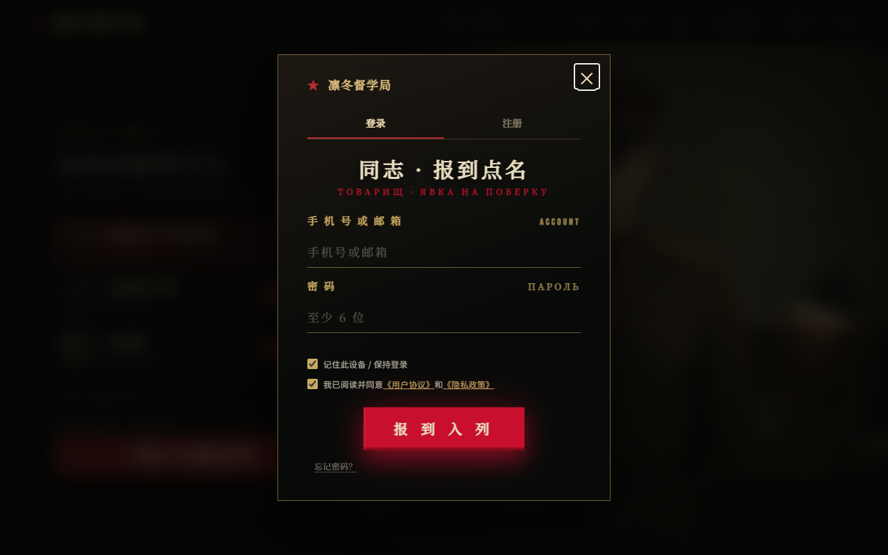
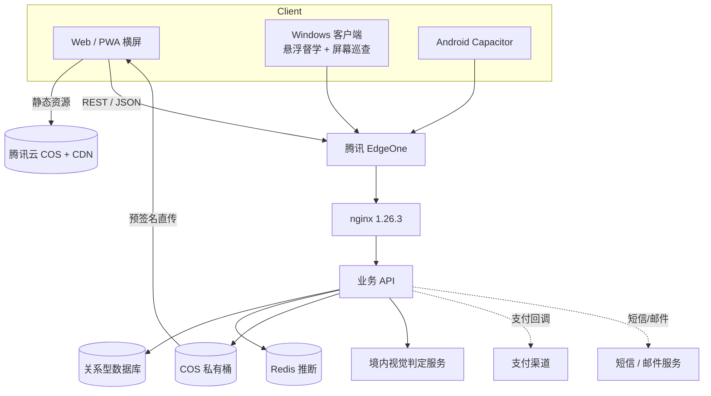

# 凛冬督学局（redwatch.top）拆解

> 调研时间：2026-11-07。方法：公开页面抓取 + 前端 bundle 静态分析 + 公开 API 探测 + 实际浏览器走查。
> 结论中标注「实测」的是可直接观测的事实，标注「推断」的是基于工程经验的合理推测。

## 1. 速览

| 项目 | 内容 |
| --- | --- |
| 定位 | 苏维埃主题的「番茄钟 + 督学官巡查」自律工具 |
| 目标用户 | 考研 / 考公 / 考编 / 居家办公，需要外部监督的人 |
| 核心循环 | 选督学官 → 开始劳动 → 随机巡查（摄像头/屏幕）→ 判定违纪扣红星 → 撑到「光荣下班」→ 累计荣誉 |
| 平台 | Web / PWA（横屏）/ Windows 客户端 / Android（Capacitor 容器） |
| 商业化 | 军功币、特赦券、督学官 7 天体验位、Premium Pass、捐赠 |
| 前端 | Next.js App Router 静态导出，托管在腾讯云 COS |
| 后端 | 独立 API `api.redwatch.top`，nginx 1.26.3 + 腾讯 EdgeOne，REST/JSON |
| 语言 | 9 种（中、英、俄、德、西、法、葡、日、韩，实测 bundle 内字典） |
| 关键词 | 强监督、游戏化惩罚、角色经济、横屏沉浸、桌面悬浮 |

首屏（实测）：


登录墙（实测，`/app/`）：



## 2. 产品定位与心理机制

它没有把自己做成「计时器」，而是做成一个**有惩罚的虚拟劳动单位**：

- **存在感监督**：督学官不干涉劳动，但会不定时出现。文案自己说得很清楚——「他们不直接干涉你的工作，但存在本身就是监督」。
- **可变比率惩罚**：巡查时间不确定，摸鱼被抓是概率事件，比固定提醒更有威慑力（行为心理学里的可变比率强化）。
- **损失厌恶**：每场 3 颗红星，扣完当场遣返并生成违纪档案，还带照片。
- **沉没成本 + 只增不减**：荣誉时长和等级「只增不减」，被遣返也不清空，保护长期动机。
- **仪式感**：敬礼、光荣下班、军功币、营房、军需处、征召投票——把自律包装成一套可扮演的身份。

这套设计解决的是普通番茄钟最大的问题：**开着计时器照样刷手机**。

## 3. 功能地图（实测）

### 3.1 专注循环

- 默认 25 分钟专注 + 5 分钟休息，可配置轮次。
- 「无限时长」模式：不分轮次、不强制休息，直到主动下班。
- 累计专注达到门槛后，「下班」变为「光荣下班」，才算完成一次正式服役。
- 可中途退出，但只保留有效专注，不触发「光荣下班」。

### 3.2 巡查（核心差异点）

- 开工前二选一：**摄像头巡查** 或 **电脑屏幕巡查**（桌面端）。
- 巡查不定时触发，读取**当次单帧**，不上传连续视频、不采集麦克风。
- 判定结果：专注 / 疲劳 / 人不全 / 离岗 / 玩手机 / 严重分心。
- 疲劳、人不全会先警告，累计或反复异常才扣星。
- 屏幕巡查会区分「学习/工作」「私人闲聊」「其他非学习内容」，且「私人闲聊是否扣星」在开工前锁定。
- 巡查频率可调；「噩梦模式」按在线人数动态开放，超过上限只保留已启用者。
- 支持校准（`/patrol/calibrate`）和申诉/确认（`/patrol/confirm`），说明官方承认判定有误差。

### 3.3 纪律与惩罚

- 每场 3 颗红星：离岗、玩手机、分心各扣一颗。
- 三颗扣光 → 本场结束 + **违纪档案**（含违纪照片），可在档案页查看。
- 同一业务日（北京时间 04:00 切换）被遣返 3 次 → 播放押送过场 → **地牢封禁 8 小时**。
- 服刑期间优先消耗库存「特赦券」；无券可用军功币购买特赦立即释放。

### 3.4 成长：劳动荣誉册

- 8 级徽章，从「荣誉启封章」到「千时荣光章」，按累计有效专注时长晋升。
- 等级与荣誉时长只增不减；删除单场档案不影响累计。
- 荣誉墙可把多枚徽章挂进营房；HUD 有荣誉榜（按累计时长排名）。

### 3.5 社交：战友 + 小队

- 关注/粉丝式「战友」名册，可看到在线、劳动中、离线，以及今日专注、累计时长、连续天数。
- 可发「鼓励」「催促」等战地信号，记录在战地日志。
- 「一起劳动」：2–4 人小队，队长邀请/公开招募/随机匹配，队员各自选巡查方式并准备，队长「全队开始」。
- 学习中可「申请休息」5/10/15 分钟，队友同意后全队休息；等待回复时继续学习。
- 个人下班不影响队友；可再次准备或退出小队。

### 3.6 元游戏

- **征召系统**：公开角色候选，消耗军功币投票，结果决定版本方向；讨论区发帖/回复也消耗军功币。
- **营房装饰**：军需处购买搪瓷缸、台灯、锦旗、收音机等；可拖动、四向微调（1px/10px）、缩放、调前后层级；白板/黑板/相框/时钟可设置内容；手机/平板/电脑共用同一套房间坐标。
- **动作库**：解锁督学官动作，每名督学官的每种巡查用途至少保留一个动作。
- **军功币**：坚持劳动、每日签到获得；用于解锁动作/装饰、征召互动、买特赦。

### 3.7 账号与安全

- 手机号或邮箱 + 密码登录；支持验证码注册、手机/邮箱绑定、找回密码、注销账号。
- ALTCHA 人机验证（`/auth/capabilities` 返回 `altcha: true`），不是 Turnstile/reCAPTCHA。
- 登录设备可「记住此设备」；有 refresh token 流程。
- 限流：`/auth/capabilities` 返回 `x-ratelimit-limit: 60`、`remaining`、`reset`。

### 3.8 多端

- Web/PWA：`manifest.webmanifest` 的 `start_url` 为 `/app/`，`orientation: landscape`，深色主题。
- Windows 客户端：支持软件内摄像头、完整屏幕巡查、**悬浮督学**（悬浮在其他窗口之上）。
- Android：bundle 内可见 `RedWatchTutorAndroid/` UA、`Capacitor` 平台判断，说明用 Capacitor 套壳；但 FAQ 明确「当前不提供 APK 或其他安装包下载」，属于灰度/内测能力。
- 移动端适配：`android-app`、`visualViewport`、横屏比例处理都有专门分支。

### 3.9 运营

- 公告系统（`/announcements`、`/announcement/seen`）、FAQ 内容接口（`/content/faqs`）。
- 埋点：`/track/visit`、`/track/ping`、`/track/error`、`/track/product-event`、`/track/settings`。
- 每周 1–2 次更新，军需处公告板发布变更。
- 有 B 站、抖音、小红书官方账号（bundle 内链接）。

## 4. 技术栈

| 层 | 选型 | 证据 |
| --- | --- | --- |
| 前端框架 | Next.js App Router（React），静态导出 | `/_next/static/chunks/app/page-*.js`、`layout-*.js`，HTML 直出但内容由 RSC payload + 客户端渲染 |
| 静态托管 | 腾讯云 COS + CDN | 响应头 `Server: tencent-cos`、`X-NWS-LOG-UUID`、`x-cos-request-id` |
| 样式 | 手写 CSS（多入口 CSS 文件），非 Tailwind | 首页加载 10 个 `/_next/static/css/*.css`，类名如 `nav-menu-item` |
| 状态 | Zustand（含 persist） | bundle 内 `zustand persist middleware` 字符串与实现 |
| 本地存储 | IndexedDB | 巡查/档案/缓存的 IDB 事务封装 |
| 实时 | 未发现 WebSocket/SSE 客户端；以 REST + 轮询/心跳为主（推断） | bundle 内无 `EventSource`/`socket.io`/`ws://` 业务代码，但有 `/track/ping`、`/sync/*` |
| API | 自建 REST，`https://api.redwatch.top` | bundle 内常量 `eN="https://api.redwatch.top"`，路径必须 `/` 开头 |
| 网关 | nginx 1.26.3 + 腾讯 EdgeOne | 响应头 `Server: nginx/1.26.3`、`EO-LOG-UUID`、`EO-Cache-Status`、NEL 上报 `teo-rum` |
| 对象存储 | 腾讯云 COS，前端直传（预签名 POST） | 巡查图片上传使用 `FormData` + 服务端下发 `uploadUrl`/`formFields`，`credentials: "omit"` |
| 人机验证 | ALTCHA（PoW） | `/auth/capabilities` → `{"altcha":true,...}` |
| 移动端 | Capacitor | `Capacitor`、`capacitorPlatform`、`RedWatchTutorAndroid/` UA |
| 数据 | 关系型数据库（推断 MySQL/PostgreSQL） | 有账号、会话、档案、订单、库存等强关系数据；具体类型未暴露 |
| 缓存/队列 | 推断 Redis（巡查任务、限流、在线数） | 有 `patrolTasks`、动态开放的噩梦模式、在线人数上限 |
| 视觉判定 | 境内第三方视觉服务（推断） | 隐私页明确「可能委托境内第三方技术服务商即时处理」 |

补充：`/health` 暴露了能力开关，能反推后端模块划分：

```json
{
  "status": "ok",
  "businessDayPolicy": { "version": 1, "timezone": "Asia/Shanghai", "startTime": "04:00" },
  "capabilities": {
    "paymentCreateV2": true,
    "inviteMilestonesV1": true,
    "patrolTasks": true,
    "nativeAndroidSessionV1": true,
    "patrolCosUploads": true,
    "archiveCosUploads": false,
    "supplyDecorationCatalogVersion": 1,
    "supplyDecorationCatalogItems": 309,
    "decorLayout": { "version": 3, "supervisorScoped": true, "itemMax": 256,
                     "jsonMaxLength": 65536, "scaleMin": 0.1, "scaleMax": 8,
                     "coordinateMin": -100, "coordinateMax": 200 },
    "supervisorEntitlementsV1": true
  }
}
```

这段健康检查信息量很大：业务日 04:00 切、装饰目录 309 件、房间坐标范围、每个督学官独立的装饰布局、按督学官卖权益（`supervisorEntitlementsV1`）。

## 5. 架构还原



要点：

1. **前后端彻底分离**。站点是纯静态导出，所有动态能力走 `api.redwatch.top`，两者不同域，所以 API 有完整 CORS（`Vary: Origin`、`Access-Control-Allow-Origin`）。
2. **静态站点的收益**：营销页/SEO 页面可以走 CDN 缓存，几乎零成本；发版只推 COS；API 独立扩容，不被页面流量拖累。
3. **图片不经过业务服务器**。巡查帧由服务端签发上传票据，前端直传 COS，服务端只收 ticket 和判定结果。这是典型的「先授权、再直传、后提交」三段式，避免大文件打爆 API。
4. **业务时间是服务端概念**。04:00 切日、地牢 8 小时、每日遣返次数都以服务端为准，客户端只做展示，防止改本地时间。
5. **多端共用一套 Web 代码**。Windows/Android 都是 Web 容器 + 原生能力桥（摄像头、屏幕共享、悬浮窗），所以 bundle 里有大量平台判断分支。

## 6. API 版图（从前端 bundle 提取）

| 域 | 端点 |
| --- | --- |
| 认证 | `/auth/login`、`/auth/refresh`、`/auth/logout`、`/auth/send-code`、`/auth/verify-code`、`/auth/human-challenge`、`/auth/capabilities`、`/auth/phone/register`、`/auth/phone/verify-registration`、`/auth/phone/reset-password`、`/auth/phone/bind/*`、`/auth/email/bind/*`、`/auth/delete-account/*` |
| 专注同步 | `/sync/session-progress`、`/sync/session-record`、`/sync/session-handoff/complete`、`/sync/stats`、`/sync/catch`、`/sync/catch/{id}` |
| 巡查 | `/patrol/tasks`、`/patrol/evaluate`、`/patrol/confirm`、`/patrol/calibrate`、`/patrol/unchanged-timeout`、`/patrol/image-upload-ticket`、`/patrol-archive/preference`、`/patrol-archive/frame` |
| 档案 | `/archive/image-upload-ticket`、`/me/...` 下的档案/偏好 |
| 社交 | `/social/friends/...`、`/social/preferences`、`/study/rooms/...`、`/study/preferences` |
| 军需/装饰 | `/supply`、`/supply/supervisors/...`、`/supply/messages/...`、`/supply/decor-content/...`、`/supply/labor-reward-policy`、`/decor-presets/...` |
| 支付 | `/donate/pay/create`、`/donate/offer/roll`、`/donate/offer/activate`、`/donate/offer/status` |
| 内容/运营 | `/announcements`、`/announcement/seen`、`/content/faqs`、`/track/*` |
| 用户 | `/me`、`/me/preferences`、`/me/avatar`、`/me/locale`、`/me/features`、`/me/notification-preferences` |

几个值得注意的设计：

- `session-progress` 与 `session-record` 分离：过程心跳和最终记录是两条写入路径，过程数据可以合并/丢弃，最终记录必须可靠。
- `session-handoff/complete`：支持换设备/换端续接同一场劳动。
- `donate/offer/roll` + `offer/activate`：随机权益/报价的领取与激活（推断），配合 `paymentCreateV2`。
- `patrol/image-upload-ticket` 与 `archive/image-upload-ticket` 分开，说明「巡查判定图」与「违纪留档图」是两条保留策略。

## 7. 数据模型推断

```
users(id, phone, email, password_hash, locale, avatar, created_at, deleted_at)
user_preferences(user_id, patrol_mode, patrol_frequency, archive_enabled, private_chat_penalty, ...)
sessions(id, user_id, supervisor_id, mode, planned_seconds, started_at, ended_at,
         status, stars_left, scene/decor_snapshot, client_id, timezone)
session_events(id, session_id, type, payload, created_at)        -- 心跳/暂停/恢复/巡查/扣星
patrol_tasks(id, session_id, due_at, status, attempt, result, confidence)
patrol_frames(id, task_id, object_key, uploaded_at, verdict, retained)
violation_archives(id, user_id, session_id, object_key, reason, created_at)
honor_progress(user_id, total_focus_seconds, level, updated_at)
friendships(user_id, friend_id, status, created_at)
squads(id, owner_id, status, is_public, created_at)
squad_members(squad_id, user_id, ready, patrol_mode)
currency_ledger(id, user_id, delta, reason, ref_id, created_at)
inventory(user_id, item_id, qty)
decor_layouts(user_id, supervisor_id, version, json, updated_at)
decor_catalog(id, name, price, category, asset)
conscriptions(id, title, status, ends_at)
conscription_votes(id, conscription_id, user_id, option, cost)
payments(id, user_id, provider, amount, status, raw_callback)
```

关键约束：

- `honor_progress` 只增不减，扣星/遣返不写负向流水。
- `currency_ledger` 必须是账本，不能只存余额。
- `decor_layouts` 按 `(user_id, supervisor_id)` 唯一，JSON 有 64KB 上限、坐标/缩放有硬边界——服务端校验，客户端只做交互。
- 每场 session 存 `decor_snapshot`，否则用户改装修后历史档案会「变样」。

## 8. 关键工程实现

### 8.1 巡查单帧链路

从 bundle 能还原出完整流程：

1. 客户端把画面压成 JPEG data URL（校验 `FF D8 ... FF D9`、长度 1KB–上限）。
2. 调 `requestGrant()` 拿上传票据；404 时走 legacy 兼容路径。
3. 服务端返回 `{ uploadUrl, formFields, uploadRequired }`。
4. 客户端 `FormData` 直传 COS（`credentials: "omit"`，不带 Cookie）。
5. 拿到 `imageTicket` 后调 `commitTicket` 落库。
6. 对 `alreadyAccepted` 做幂等处理；对 403/408/409/425/429/5xx 做可重试分类。

这套设计的价值：**大文件不经过 API、票据可防重放、失败可重试且幂等**。

### 8.2 端上隐私计算

- 本地先做低分辨率亮度指纹，只在内存中与「当前静止段」「最近一次成功判定帧」比较。
- 画面安全且无明显变化 → 不编码、不上传。
- 指纹不上传、不落档案；服务端只记录静止时长区间和违纪状态。
- 普通判定不留连续视频，只有违纪现场快照和「巡查留档」会保存；留档默认开启，可在设置关闭并清空云端照片。
- 会抽样留存一张静态图做质量核查，仅授权人员可见。

这是「端侧预筛 + 服务端判定 + 最小化留存」的组合，既省带宽/推理成本，也能讲清楚隐私故事。

### 8.3 时间权威

- 所有「今天」「连续天数」「业务日」都按 `Asia/Shanghai 04:00` 切。
- 进度心跳可合并（env `NEXT_PUBLIC_SESSION_PROGRESS_COALESCE_ENABLED`），减少写放大。
- 最终记录单独提交，带 `client_id` 做幂等；换端用 handoff 续接。

### 8.4 静态化带来的工程约束

- 所有环境变量都是 `NEXT_PUBLIC_*`（构建期注入），所以同一份产物切环境要靠重新构建。
- API base 可以走 `NEXT_PUBLIC_ADMIN_API_BASE` 覆盖，说明有「同源代理」和「独立域名」两种部署形态。
- 媒体走 `NEXT_PUBLIC_MEDIA_BASE`，方便把图片/音频迁到 CDN 或独立桶。

## 9. 商业化与增长

| 手段 | 说明 |
| --- | --- |
| 军功币 | 劳动/签到获得，也可通过支付获取（推断） |
| 特赦券 | 地牢免罚，稀缺道具，天然付费点 |
| 督学官 | 3 位可见，2 位标「7 天体验」，到期转化 |
| Premium Pass | 前端有 `NEXT_PUBLIC_ENABLE_PREMIUM_PASS` 开关 |
| 捐赠 | `/donate/` 路由 + `pay/create` |
| 征召投票 | 花币参与版本决策，提升留存与社区感 |
| 邀请里程碑 | `inviteMilestonesV1` 能力开关，说明有邀请奖励 |

增长侧：B 站/抖音/小红书内容 + 「被抓摸鱼」的戏剧性截图，天然适合传播。

## 10. 设计分析：为什么这套东西有效

1. **把抽象的「专注」变成可输赢的局**：3 颗星、遣返、地牢，规则简单，反馈即时。
2. **惩罚有梯度**：警告 → 扣星 → 遣返 → 地牢，不会一次失误就劝退。
3. **荣誉不可逆**：只增不减，长期用户不会因为一次失败放弃。
4. **角色即身份**：选督学官、装修营房、挂徽章，把工具变成「我的岗位」。
5. **社交是轻的**：战友、信号、小队，但不做重聊天，避免自习室变聊天室。
6. **隐私叙事完整**：单帧、端侧指纹、可关闭留档、可清空，降低了摄像头的接受门槛。

## 11. 风险与短板

- **判定误差**：视觉判定必然有误报，必须保留申诉/校准，否则用户会流失。
- **隐私合规**：摄像头 + 屏幕内容属于敏感个人信息，境内需要清晰的告知同意、最小化、留存期限、第三方受托处理清单；未成年人场景风险更高。
- **惩罚过重**：8 小时地牢对轻度用户可能过激，需要「宽松档」。
- **多端维护成本**：Web + Windows + Android 三套壳，平台判断分支会越来越多。
- **静态导出的迭代成本**：每次改环境变量都要重建；SEO 页面和 App 在一个产物里，缓存策略要很小心。
- **单点 API**：所有端共用一个 API 域名，限流 60/min 对巡查高频场景偏紧（应有独立配额）。

## 12. 可直接复用的清单

- 「单帧 + 端侧预筛 + 票据直传」的巡查链路。
- 业务日 04:00 切日的实现（比 00:00 更符合熬夜学习人群）。
- 只增不减的荣誉账本。
- 过程心跳与最终记录分离的同步模型。
- 装饰布局的服务端硬约束（坐标/缩放/JSON 大小）。
- 静态站 + 独立 API + 对象存储直传的低成本部署形态。
- 用 `/health` 暴露能力开关，方便灰度与多端兼容。
