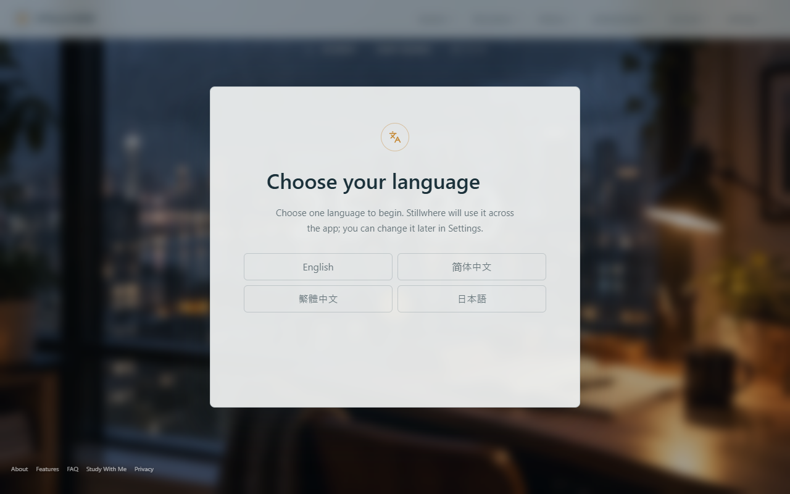
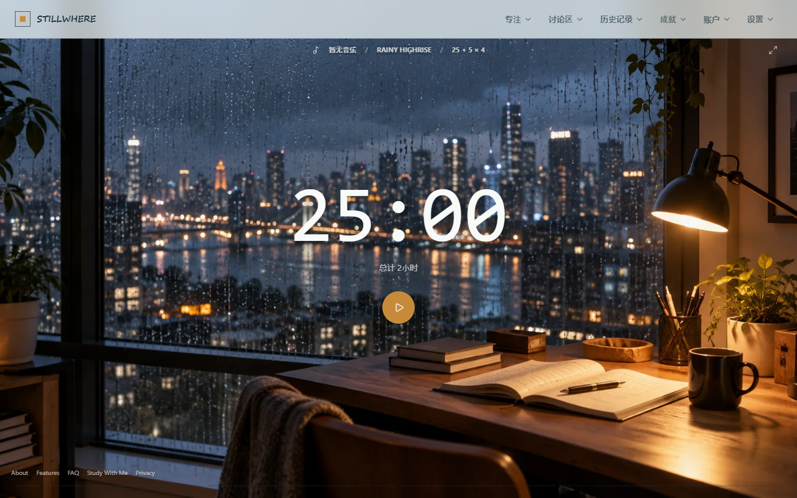
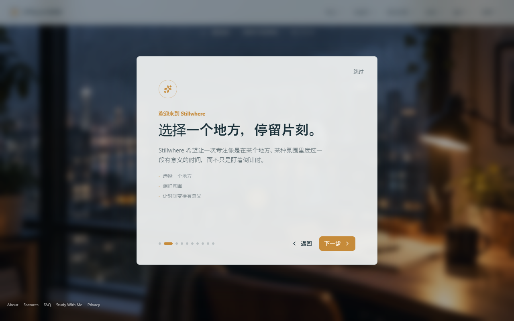
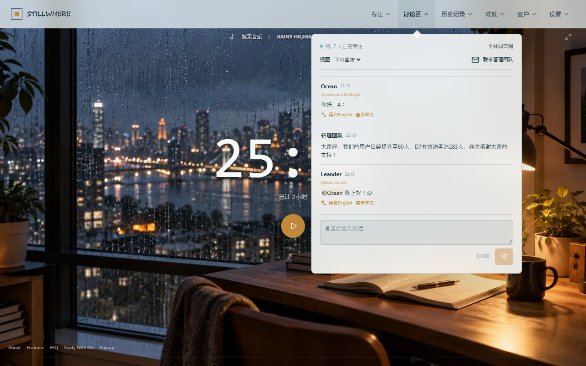
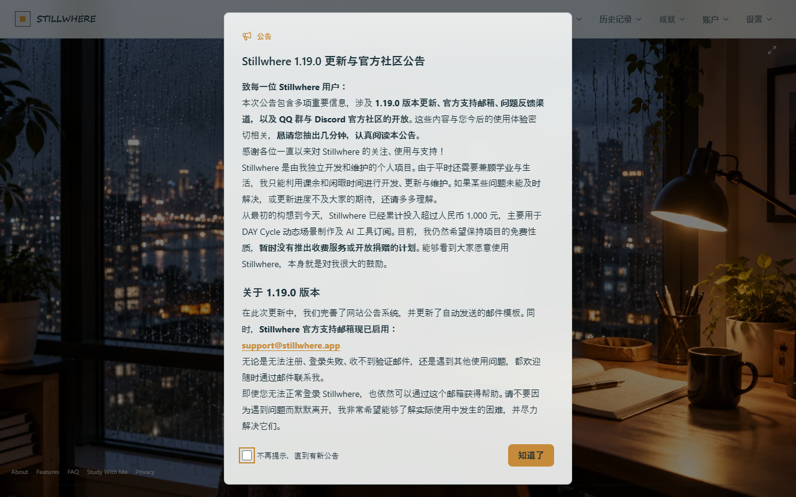
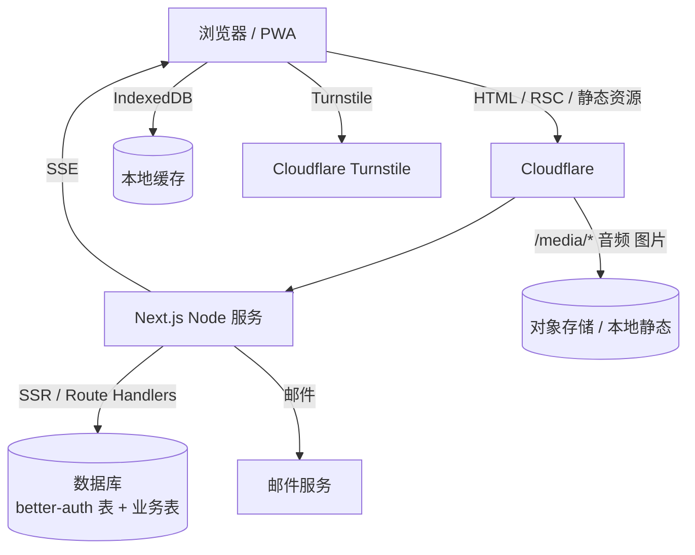

# Stillwhere（stillwhere.app）拆解

> 调研时间：2026-11-07。方法：公开页面抓取 + 前端 bundle 静态分析 + 公开 API 探测 + 实际浏览器走查（简体中文界面）。
> 这是一个**独立开发者**项目：站内公告显示当前版本 1.19.0，累计投入约 1000 元人民币，暂不收费、不开捐赠。

## 1. 速览

| 项目 | 内容 |
| --- | --- |
| 定位 | 沉浸式在线自习空间（Immersive Study Space） |
| 灵感 | Study With Me 视频：有房间、有声音、有计时，但「房间/声音/节奏」由你决定 |
| 目标用户 | 需要「开始仪式感」和「安静陪伴」的人，不想要摄像头和强监督 |
| 核心循环 | 选场景 → 调声音 → 设计时 → 专注 → 记录/成就 → 下次再来 |
| 平台 | 浏览器 / PWA（可添加到主屏） |
| 商业化 | 免费，无付费墙；作者自述暂不收费、不开捐赠 |
| 前端 | Next.js App Router（RSC）+ React + Tailwind + Radix/shadcn |
| 后端 | Next.js Route Handlers（Node 服务，Cloudflare 前置） |
| 实时 | SSE（`EventSource`）推送社区事件，不是 WebSocket |
| 认证 | better-auth（邮箱密码 + 验证邮件），Cloudflare Turnstile 人机验证 |
| 语言 | 4 种（en / zh-Hans / zh-Hant / ja），路由前缀 + hreflang |
| 关键词 | 氛围、场景、声音、低压力陪伴、游客优先、本地优先 |

首屏语言选择（实测）：



主界面（实测，Rainy Highrise 场景）：



## 2. 产品定位

Stillwhere 卖的不是「监督」，而是**进入状态的那一下**。官方原话：

> Starting can be harder than keeping time. Stillwhere was made to make the moment of sitting down feel a little easier: choose a place, find a sound, and begin.

它把 Study With Me 的「陪伴感」拆成三个可配置的维度：

1. **地点**（场景库：真实取景、动态环境、视频背景）。
2. **声音**（音乐 / 环境音 / 白噪音 / 安静）。
3. **时间**（番茄钟 / 倒计时 / 秒表）。

社区是「环境音级别的陪伴」：能看见有人在一起学，但不需要聊天、不需要开摄像头。

## 3. 功能地图（实测）

### 3.1 首次进入

- 语言选择（English / 简体中文 / 繁體中文 / 日本語），选择后全站生效，可在设置改。
- 3 步引导：**选择一个地方 → 调好氛围 → 让时间变得有意义**，可跳过。
- 引导文案强调「像在某个地方、某种氛围里度过一段有意义的时间，而不只是盯着倒计时」。



### 3.2 专注面板

顶部导航：专注 / 讨论区 / 历史记录 / 成就 / 账户 / 设置。

「专注」下拉是三个 Tab：

| Tab | 能力 |
| --- | --- |
| 场景 | 播放模式（视频循环 / 图片轮播）、是否包含已看过的场景、提前准备秒数（实测 2s）、即将播放队列、AI 生成背景库（可开关「自动」）、按日期分组的场景列表（标注「图片 · 1672×941」「Stillwhere AI」） |
| 音乐 | 音乐 / 环境音 / 白噪音 / 关闭，音量控制 |
| 计时器 | 番茄钟 / 倒计时 / 秒表；专注时长、休息时长、轮数；暂停/继续、跳过番茄阶段 |

主界面元素很少：场景全屏、居中大号倒计时、下方「总计 2 小时」、一个播放按钮、顶部一条极窄的状态条（音乐 / 场景名 / 节奏 `25 + 5 × 4`）。控件「需要时靠近，开始时退后」。

### 3.3 DAY Cycle

- 选定场景会随一天中的时段变化：早晨、正午、下午、黄金时刻、蓝调时刻、夜晚。
- 可以跟随本地时间，也可以模拟另一个时段。
- 这是它区别于普通「换壁纸」的核心：**同一个空间的四时变化**。

### 3.4 声音

- 音乐、环境音、白噪音三类，可分别调音量，也可以完全安静。
- 音频清单是构建期生成的 `manifest.json`（实测 62KB），每条包含来源、作者、许可证、时长、响度、校验和。
- 实测素材来自 Freesound 的 CC0 音频，经过**响度归一化**（`referenceLUFS: -16.7`、`integratedLUFS: -16.74`、`truePeakDBTP`），并生成 `level-matched` 版本。
- 播放器有预加载、crossfade、页面隐藏时暂停等处理（bundle 内 `AudioPlayer` 类）。

### 3.5 历史与统计

- 「专注记录」页：总专注时长、专注次数、完成轮数；Tab 分「专注记录 / 个人统计」。
- 完成、停止、中断的专注都会出现；空状态有插画和「开始专注」。
- 统计口径克制，官方明确「不把一天变成竞赛」。

### 3.6 成就

- 共 **39** 个成就（实测页面 `0 / 39`），六边形/多边形徽章，灰阶未获得、彩色已获得。
- 分类筛选：全部 / 已获得 / 未获得。
- 示例：初次见面（完成账号注册）、第一声问候（首次发表可显示的讨论消息）、番茄起步（番茄钟保存至少 60 秒有效专注）。
- 游客也能看成就墙，但云同步需要登录；页面提供「导出我的数据」。

### 3.7 讨论区

- 顶部显示「7 人正在专注」「一个共同空间」。
- 消息带场景标签（如 `Snowbound Midnight`）、时间、作者；支持「译自 English · 查看原文」。
- 输入框 200 字上限；未登录显示「登录后加入对话」。
- 提供「联系管理团队」「视图下拉面板」。
- 官方账号会发产品公告（例如「用户已提升至 69 人，D7 有效访客达 283 人」）。



### 3.8 公告系统

- 启动弹窗展示版本更新与社区公告，可勾选「不再提示，直到有新公告」。
- 公告内容包括：1.19.0 版本、官方支持邮箱 `support@stillwhere.app`、QQ 群与 Discord 开放。
- 这条公告也暴露了项目体量：**个人独立开发、课余维护、免费**。



### 3.9 游客优先

- 不登录即可开始专注，数据存本地（IndexedDB / localStorage）。
- 账号是可选的，只用于「符合条件的专注历史跨设备同步」。
- 提供数据导出（`/api/account/export`）。
- 社区可以整体隐藏，回到「一个人自习」。

### 3.10 账号与管理

- 邮箱 + 密码注册/登录，邮件验证、找回密码；Turnstile 人机验证。
- 账户页可见同步状态、导出、删除。
- 管理侧：`/api/management/inbox`（反馈/举报收件箱）、`/api/account/access`（管理员标记）、公告发布、社区举报处理、翻译管理。

## 4. 技术栈

| 层 | 选型 | 证据 |
| --- | --- | --- |
| 框架 | Next.js App Router + React Server Components | 响应头 `vary: rsc, next-router-state-tree, ...`；`/_next/static/chunks/app/*` |
| UI | Tailwind CSS + Radix UI / shadcn 风格组件 | DOM 中 `data-slot="dialog-content"`、`radix-*` id、大量 Tailwind 原子类 |
| 状态 | Zustand（含 persist） | bundle 内 `zustand persist middleware` |
| 本地存储 | IndexedDB（音乐缓存/场景）、localStorage（偏好） | `indexedDB.open("stillwhere", 1)`、`music-tracks` store |
| 认证 | better-auth | bundle 内 `better-auth:broadcast-channel`、`BetterAuthError`、`/api/auth` |
| 人机验证 | Cloudflare Turnstile | `challenges.cloudflare.com/turnstile/v0/api.js`，`/api/account/status` 返回 `siteKey` |
| 实时 | SSE（Server-Sent Events） | `new EventSource("/api/community/events")` |
| 部署 | Cloudflare 前置 + Node 源站（推断自建/VPS） | `Server: cloudflare`、`cfOrigin;dur=126`、`cf-cache-status: DYNAMIC`；不是 Workers（无 `x-opennext`） |
| 媒体 | 同源 `/media/*` 静态文件 + JSON manifest | `/media/audio/manifest.json`、`/media/frames/...`、场景图 1672×941 |
| 监控 | Cloudflare Web Analytics + 自建媒体性能上报 | `static.cloudflareinsights.com/beacon.min.js`、`/api/media-performance` |
| PWA | manifest + standalone | `display: standalone`、`theme_color #101617` |
| i18n | 路由前缀（`/zh-Hans/...`）+ hreflang | sitemap 四语言互链 |

### 4.1 前端 bundle 规模

- 首屏 24 个 JS chunk，合计约 **1.31 MB**（未压缩传输前）。
- 没有引入 Three.js / Pixi 等重型 3D 库；场景是**视频/图片**而不是实时 3D。
- 音频播放是自研 `AudioPlayer`（Web Audio + `<audio>` + Object URL 缓存），没有用 Howler。

### 4.2 后端 API 版图（从前端 bundle 提取）

| 域 | 端点 |
| --- | --- |
| 账号 | `/api/account/status`、`/api/account/access`、`/api/account/export` |
| 认证 | `/api/auth/*`（better-auth） |
| 同步 | `/api/sync`、`/api/sync?...` |
| 专注/成就 | `/api/achievements`、`/api/achievements/notices`、`/api/achievements/population` |
| 社区 | `/api/community/events`（SSE）、`/api/community/messages`、`/api/community/messages/{id}`、`/api/community/presence`、`/api/community/participants`、`/api/community/profile`、`/api/community/reports`、`/api/community/mentions`、`/api/community/translations` |
| 公告/通知 | `/api/announcements`、`/api/announcements/impressions`、`/api/notifications` |
| 管理 | `/api/management/inbox` |
| 观测 | `/api/analytics/event`、`/api/media-performance` |

设计特征：

- **SSE 而不是 WebSocket**：社区只需要「有人加入/离开/新消息」这种单向推送，SSE 更简单、过代理更稳、断线由浏览器自动重连。
- **没有 `/api/rooms`**：所有人共享「一个共同空间」，不做多房间。产品上刻意保持「小」。
- **`achievements/population`**：成就的全局获得率，用于展示稀有度。
- **`community/translations`**：用户可翻译他人消息，服务端存译文，前端切换原文/译文。

## 5. 架构还原



- 页面请求走 Cloudflare，动态请求 `cf-cache-status: DYNAMIC` 回源；静态资源可缓存。
- 媒体和站点同源（`/media/...`），部署简单，但会占用 Web 服务带宽；量大时应迁到 R2/COS。
- SSE 连接由 Next.js Route Handler 维持，属于长连接，部署时要注意反代超时和实例数量。

## 6. 数据模型推断

```
users(id, email, name, email_verified, created_at, ...)          -- better-auth
sessions(id, user_id, mode, planned_seconds, focus_seconds,
         started_at, ended_at, status, scene_id, timezone, client_id)
achievements(id, key, name, description, rule_json, badge_asset)
user_achievements(user_id, achievement_id, unlocked_at, progress_json)
messages(id, user_id, body, scene_id, locale, created_at, deleted_at)
message_translations(message_id, locale, body, translator_id)
presence(user_id, last_seen_at, session_id, scene_id)             -- 可内存/Redis
reports(id, reporter_id, target_type, target_id, reason, status)
announcements(id, locale, title, body, published_at, version)
announcement_impressions(announcement_id, user_id, seen_at)
notifications(id, user_id, type, payload, read_at)
media_assets(id, kind, path, width, height, duration, loudness, license)
```

几个约束：

- `sessions.focus_seconds` 是**结算后的有效专注**，不是墙钟时间。
- `achievements.rule_json` 让成就是「配置」而不是「硬编码」，方便加到 39 个以上。
- `messages` 保留 `scene_id`，讨论区才能显示「在哪个场景说的」。
- 游客数据在本地有独立 schema，登录后走 `/api/sync` 合并，必须有冲突策略（取并集/取最大/按时间）。

## 7. 关键工程实现

### 7.1 游客优先的本地优先架构

- 未登录：Zustand + persist 落 localStorage，音频/场景缓存落 IndexedDB。
- 登录：拉 `/api/sync`，把本地 session 合并上云；`/api/account/export` 可导出全量。
- 好处：首屏零门槛，转化路径短；坏处：同步冲突、游客数据丢失、跨设备体验割裂，需要明确的产品文案。

### 7.2 媒体内容流水线

从 `manifest.json` 能看出作者做了相当认真的内容工程：

- 素材来源可追溯（Freesound 页面、作者、CC0 许可证、原始文件名、原始校验和）。
- 统一转成 `pcm_s24le` WAV，做**响度归一化**到约 -16.7 LUFS，并记录 true peak。
- 生成 `level-matched` 版本，保证切歌不炸耳。
- 场景图统一 1672×941，按日期归档，标注「Stillwhere AI」。
- 「提前准备 2 秒」+「即将播放」队列，本质是**预加载与 crossfade**，避免切场景时黑屏/爆音。

### 7.3 场景系统

- 场景不是 3D 实时渲染，而是「图片 / 视频循环 / 图片轮播」三种播放模式。
- DAY Cycle 让同一场景有多时段变体，按本地时间选片。
- 「AI 生成背景库」可自动把新生成的场景加入轮播，解决内容产能问题。
- 播放模式、是否包含已看过、准备秒数都是用户可配置的，避免「每次都一样」的疲劳。

### 7.4 成就系统

- 39 个成就，覆盖：注册、首次发言、首次番茄、累计时长、连续天数、社区行为、场景探索等。
- 成就是「规则 + 阈值 + 徽章资源」，在 session 结算时评估；有全局获得率接口，可做稀有度展示。
- 游客也能本地记录进度，登录后合并。

### 7.5 观测与运维

- `/api/media-performance` 上报媒体加载耗时（`keepalive`，采样），用于优化首屏。
- Cloudflare Web Analytics 做基础流量。
- 公告系统带版本号和「已读」记录，是低成本的活动/更新触达手段。
- 管理收件箱 + 举报接口，说明有基本的内容治理闭环（单人项目里很难得）。

## 8. 商业化与成本

- 完全免费，作者明确「暂时没有推出收费服务或开放捐赠的计划」。
- 成本主要是：域名、服务器、对象存储/带宽、AI 生图、邮件。作者自述累计投入约 1000 元。
- 这种体量下，成本可控的关键是：**场景用图片/短视频而不是实时 3D，音频用 CC0 素材 + 构建期归一化，媒体同源托管**。

## 9. 设计分析：为什么它「留得住人」

1. **降低启动摩擦**：不用注册、不用选房间、不用等匹配，选个地方就开始。
2. **氛围而非压力**：没有摄像头、没有排名、没有惩罚；「quiet companionship」是产品承诺。
3. **控件退后**：全屏场景 + 大计时器，UI 只在需要时出现，符合「沉浸」目标。
4. **四时变化**：DAY Cycle 让同一个空间有「今天不一样」的感觉，提升回访。
5. **克制的统计**：不把数据做成竞赛，避免焦虑型用户流失。
6. **内容可扩展**：场景/音频都是「资源 + manifest」，加内容不用改代码。

## 10. 风险与短板

- **约束力弱**：对「开着计时器刷手机」的人，它没有强制手段；这是与 Redwatch 的根本分野。
- **单人维护**：bus factor = 1；公告里也承认更新速度受学业影响。
- **同步冲突**：游客 → 登录的合并策略如果不够好，容易丢数据。
- **内容成本**：场景/音频要持续产出，否则「场景库」会腻；AI 生图能缓解但质量参差。
- **社区规模小**：69 人、7 人在线，讨论区容易冷场；「一个共同空间」在人数少时反而显得空。
- **SSE 长连接**：实例扩容/重启会断流，需要重连与补偿；大量在线时要换 pub/sub。
- **无原生 App**：移动端只能靠 PWA，后台计时/通知能力受限。

## 11. 可直接复用的清单

- 「场景 + 声音 + 计时」三件套的沉浸式布局：全屏场景、单一主行动、控件退后。
- 场景 manifest + 预加载 + crossfade + 「提前准备 N 秒」。
- 音频响度归一化 + level-matched 版本 + 许可证元数据。
- DAY Cycle（按时段切场景变体）。
- 游客优先 + 可选账号 + 数据导出。
- SSE 做「轻社区」：在线人数、消息、公告，不做重聊天。
- 成就规则配置化 + 全局获得率。
- 公告弹窗 + 「不再提示直到新公告」。
