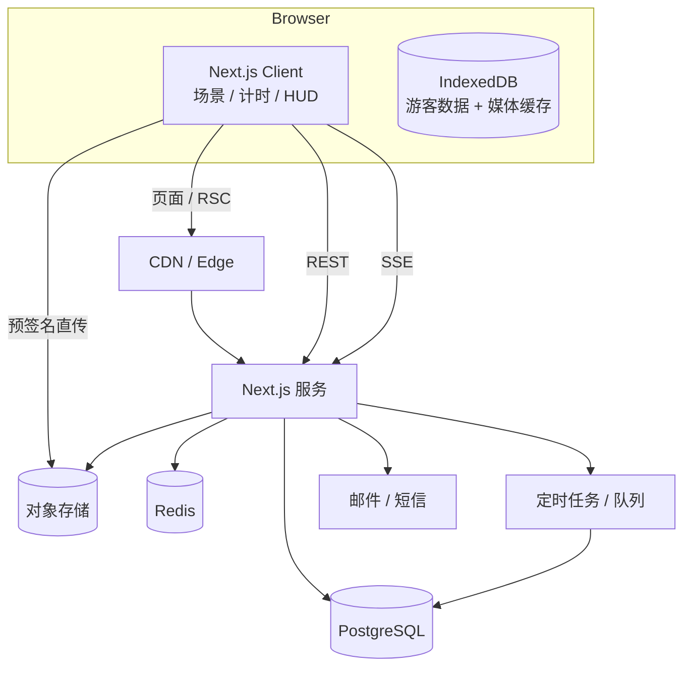
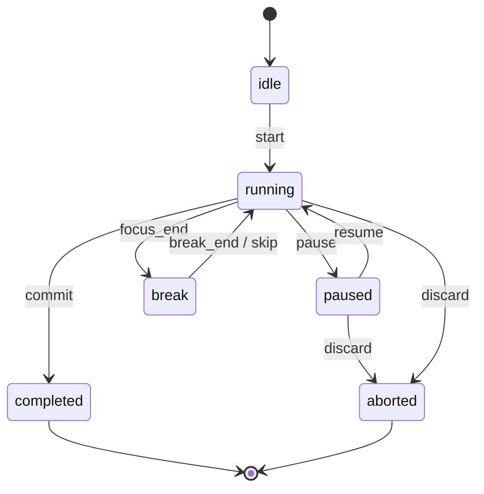

# 如果要做 LearningRoom：架构与技术选型建议

> 前置阅读：`01-redwatch.md`、`02-stillwhere.md`、`03-landscape.md`。
> 下面是基于这两套产品的取舍建议，不是唯一答案；先定范式，再定栈。

## 1. 先做三个决定

### 决定一：做哪种范式？

| 方向 | 核心卖点 | 技术重点 | 成本 | 风险 |
| --- | --- | --- | --- | --- |
| A. 氛围型（Stillwhere 路线） | 场景 + 声音 + 计时，低压力 | 媒体管线、首屏性能、内容供给 | 低 | 约束弱、内容会腻 |
| B. 监督型（Redwatch 路线） | 巡查 + 惩罚 + 荣誉，强约束 | 摄像头/屏幕、视觉判定、合规 | 高 | 隐私、误判、口碑 |
| C. 混合型 | 氛围打底 + 轻监督（承诺/连续天数/小队） | 以上两者 + 社交 | 中 | 容易做成四不像 |

**建议：先 A，留 B 的接口。** 理由：

- A 的单人体验天然成立，不依赖冷启动。
- B 的摄像头链路涉及敏感个人信息、第三方视觉服务、留存合规，早期做会拖慢一切。
- A 的「场景 + 声音 + 计时 + 记录」是任何范式的地基，先做不浪费。
- 如果以后要加监督，先加「轻约束」：连续天数、公开承诺、小队互相看见，而不是一上来就摄像头。

### 决定二：面向哪个市场？

- **国内**：需要 ICP 备案/公安备案、支付资质、内容审核；媒体用腾讯 COS + EdgeOne 或阿里 OSS + CDN；登录用手机号验证码。
- **海外**：Stripe/Lemon Squeezy、Google/Apple 登录、Cloudflare R2、无备案；但要处理 GDPR/CCPA。

两边都做会让认证、支付、合规复杂度翻倍。**先选一个。**

### 决定三：单人还是团队？

- 单人：优先托管服务（Supabase/Neon + Vercel/Cloudflare），少碰自建长连接和视频。
- 小团队：可以自建 Postgres + Redis + LiveKit，但要有人负责运维。

## 2. 推荐技术栈（A 路线，单人/小团队）

| 层 | 选择 | 理由 | 替代 |
| --- | --- | --- | --- |
| 框架 | Next.js 15 App Router + TypeScript | RSC 做 SEO 落地页，Route Handlers 做 BFF，和 Stillwhere 同构 | Remix / SvelteKit |
| UI | Tailwind CSS + shadcn/ui + Radix | 快速做出克制的界面；无障碍基础好 | Mantine / Chakra |
| 状态 | Zustand + TanStack Query | 本地 UI 状态 + 服务端缓存分离 | Jotai / SWR |
| 本地存储 | IndexedDB（idb 库） | 游客模式、音频/场景缓存 | localForage |
| 数据库 | PostgreSQL（Neon / Supabase / 自建） | 关系型数据（session/成就/账本）天然合适 | MySQL |
| ORM | Drizzle | 类型安全、SQL 透明、迁移简单 | Prisma |
| 认证 | better-auth（邮箱/OTP）或 Supabase Auth | Stillwhere 已验证 better-auth 可行 | Clerk / Auth.js |
| 实时 | SSE（`/api/events`）+ Redis pub/sub | 人数/状态/轻消息足够；比 WebSocket 简单 | WebSocket / Ably / Pusher |
| 缓存/限流 | Redis（Upstash） | presence TTL、rate limit、排行 | 内存（单机） |
| 对象存储 | Cloudflare R2 / 腾讯 COS | 场景图/音频/视频；预签名直传 | S3 / 阿里 OSS |
| 媒体处理 | ffmpeg（响度归一化）+ sharp（尺寸变体） | 复刻 Stillwhere 的音频/图片管线 | 云转码 |
| 后台任务 | Vercel Cron / Cloudflare Queues / BullMQ | 日统计、成就回填、清理 | 自建 cron |
| 监控 | Sentry + PostHog/Umami | 错误 + 产品分析 | 自建 |
| 部署 | Vercel + Neon（最快）或 Cloudflare + VPS | 先快后稳 | Fly.io / Railway |

### 2.1 为什么不上来就 WebSocket / WebRTC

- 自习室 90% 的实时需求是「谁在、在学什么、说句话」，SSE 全够。
- SSE 走 HTTP，代理/防火墙友好，浏览器自动重连，服务端实现简单。
- WebRTC 只在「视频/语音房」时才需要，届时用 LiveKit Cloud 或自建 SFU，不要把信令、TURN、录制一起自己写。

## 3. 参考架构



### 3.1 模块划分

```
app/
  (marketing)/            落地页、about、faq（SEO，静态优先）
  (room)/                 主场景（全屏、客户端组件）
  (account)/              登录、账户、导出
  api/
    auth/[...all]/        better-auth
    sessions/             开始/心跳/提交/历史
    sync/                 游客数据合并
    community/            presence、messages、reports（SSE 在 events）
    achievements/         列表、进度
    media/                签名直传、manifest
    admin/                公告、举报、用户
lib/
  db/                     schema + queries（Drizzle）
  session/                状态机、校验、结算
  presence/               Redis TTL + 订阅
  achievements/           规则引擎
  media/                  ffmpeg/sharp 管线
```

### 3.2 关键请求流

**开始专注**

```
POST /api/sessions
{ mode, plannedSeconds, sceneId, clientId, timezone }
→ { id, startedAt, serverNow, plannedSeconds }
```

**心跳（30–60s）**

```
POST /api/sessions/:id/heartbeat
{ seq, focusedSeconds, state }
→ { serverNow, remainingSeconds }
```

**提交**

```
POST /api/sessions/:id/commit
{ clientId, endedAt, focusedSeconds, pauseCount, checksum }
→ { session, achievementsUnlocked, streak, totals }
```

服务端校验：

- `startedAt` 与服务端记录一致，`endedAt - startedAt` 与 `focusedSeconds + 暂停` 在容差内。
- 心跳序列单调递增，缺失过多（>30%）降级为「部分有效」。
- `clientId` 幂等，重复提交返回同一结果。

## 4. 数据模型（Postgres）

```sql
create table users (
  id uuid primary key default gen_random_uuid(),
  email text unique,
  name text,
  locale text not null default 'zh-CN',
  timezone text not null default 'Asia/Shanghai',
  created_at timestamptz not null default now()
);

create table sessions (
  id uuid primary key default gen_random_uuid(),
  user_id uuid not null references users(id),
  mode text not null check (mode in ('pomodoro','countdown','stopwatch')),
  planned_seconds int not null,
  focused_seconds int not null default 0,
  status text not null check (status in ('running','paused','completed','aborted')),
  scene_id text,
  client_id text not null,
  started_at timestamptz not null,
  ended_at timestamptz,
  timezone text not null,
  created_at timestamptz not null default now(),
  unique (user_id, client_id)
);

create table session_heartbeats (
  session_id uuid references sessions(id) on delete cascade,
  seq int not null,
  focused_seconds int not null,
  state text not null,
  created_at timestamptz not null default now(),
  primary key (session_id, seq)
);

create table daily_stats (
  user_id uuid references users(id),
  day date not null,               -- 业务日，04:00 切
  focused_seconds int not null default 0,
  sessions int not null default 0,
  primary key (user_id, day)
);

create table achievements (
  id text primary key,
  name jsonb not null,             -- {zh, en, ja}
  description jsonb not null,
  rule jsonb not null,             -- {type:'total_minutes', threshold: 600}
  badge_asset text not null,
  sort int not null default 0
);

create table user_achievements (
  user_id uuid references users(id),
  achievement_id text references achievements(id),
  progress int not null default 0,
  unlocked_at timestamptz,
  primary key (user_id, achievement_id)
);

create table messages (
  id uuid primary key default gen_random_uuid(),
  user_id uuid references users(id),
  body text not null check (char_length(body) <= 200),
  scene_id text,
  locale text,
  created_at timestamptz not null default now(),
  deleted_at timestamptz
);

create table reports (
  id uuid primary key default gen_random_uuid(),
  reporter_id uuid references users(id),
  target_type text not null,
  target_id uuid not null,
  reason text not null,
  status text not null default 'open',
  created_at timestamptz not null default now()
);

create table announcements (
  id uuid primary key default gen_random_uuid(),
  version text not null,
  title jsonb not null,
  body jsonb not null,
  published_at timestamptz not null default now()
);

create table announcement_reads (
  announcement_id uuid references announcements(id) on delete cascade,
  user_id uuid references users(id) on delete cascade,
  read_at timestamptz not null default now(),
  primary key (announcement_id, user_id)
);
```

要点：

- `daily_stats` 是**物化汇总**，不要每次统计都扫全表；用提交时的增量更新 + 每日校对。
- `session_heartbeats` 可分区/定期归档，别无限增长。
- 业务日统一 04:00（Asia/Shanghai）切，服务端计算 `day`，客户端不传。
- 所有多语言字段用 `jsonb`，避免加语言要改表。

## 5. 计时器状态机



实现建议：

- 客户端只负责**展示**：`remaining = planned - (now - startedAt - pausedTotal)`。
- 页面隐藏/刷新用 `localStorage` 快照 + 服务端 `startedAt` 恢复。
- 到点用 Web Audio 播放提示音（比 `<audio>` 更可靠），同时发系统通知（需权限）。
- 提交前做一次「本地时钟 vs 服务端时钟」校正，避免时区/手动改时间导致负数。
- 断网：本地队列 + 幂等 `clientId`，恢复后补交。

## 6. Presence 设计

```
Key: presence:{scope}:{userId}   Value: {sessionId, sceneId, state}   TTL: 70s
心跳: 每 30s SET + EXPIRE
列表: SCAN/集合 + pipeline 批量 TTL 检查
推送: Redis pub/sub → SSE 连接池
```

- `scope` 可以是 `global`（Stillwhere 式单空间）或 `room:{id}`。
- 在线人数缓存 5s，避免每次请求都扫 Redis。
- 离开用显式 leave + TTL 兜底（断网/关页）。
- 不要暴露精确的「某人在学什么」给所有人；默认只显示人数和状态。

## 7. 场景与声音管线

### 7.1 资源目录

```
media/
  scenes/
    rainy-highrise/
      manifest.json        { variants: [{period:'night', image:'...', video:'...'}] }
      night-1672x941.avif
      night-1280x720.webm
  audio/
    manifest.json          { tracks: [{id,name,path,lufs,duration,license,author}] }
    rain-loop.wav
```

### 7.2 构建期处理

- 图片：`sharp` 生成 AVIF/WebP 多尺寸，移动端降级。
- 视频：`ffmpeg` 转 720p/1080p，10–15 秒无缝循环，`-movflags +faststart`。
- 音频：`ffmpeg loudnorm` 统一到 -16 LUFS，生成 level-matched 版本，记录 true peak。
- 校验和：内容哈希，便于 CDN 缓存与增量更新。
- 许可证：CC0/CC-BY 必须记录来源、作者、许可证 URL（Stillwhere 的做法值得照抄）。

### 7.3 运行时

- 首屏只加载当前场景 + 下一场景的 poster。
- 「提前准备 2 秒」= 预加载下一场景，交叉淡入。
- 音频用 Web Audio 做 crossfade，避免切歌爆音。
- `prefers-reduced-motion` 时禁用视频背景，只留静态图。

## 8. 成就与成长

- 规则 JSON：`{type:'total_minutes'|'streak_days'|'sessions_count'|'scene_count'|'community_posts', threshold, window?}`。
- 结算时批量评估该用户所有未解锁成就，命中的写 `unlocked_at`。
- 每个成就展示全局获得率（`count/unlocked / count/users`），制造稀有度。
- 连续天数按业务日计算，允许「补签卡」作为付费/奖励道具（谨慎，别破坏公平）。
- 荣誉/等级只增不减，与「可消费货币」分开记账。

## 9. 商业化（如果要做）

| 模式 | 适合 | 注意 |
| --- | --- | --- |
| 订阅（场景包/统计/去广告） | 氛围型 | 不要锁核心计时 |
| 买断（皮肤/场景 DLC） | 氛围型 | 内容要持续更新 |
| 道具（补签/特赦/装饰） | 监督/游戏化 | 别让付费绕过核心规则 |
| 1:1 匹配次数 | 匹配型 | 供给不足时别卖 |
| 打赏/捐赠 | 独立开发者 | 支付合规 |

早期建议：**核心功能永久免费，只卖「内容」和「装饰」**，不要卖「专注能力」。

## 10. 隐私与合规

- 不采集摄像头/屏幕是最大的合规优势；如果要做，必须：
  - 明确告知 + 单独同意 + 可撤回；
  - 单帧、端侧预筛、最小留存、可删除；
  - 第三方受托处理清单；
  - 未成年人保护策略。
- 国内：ICP 备案、公安备案、隐私政策、用户协议、内容审核机制。
- 海外：GDPR 的数据导出/删除、Cookie 同意、DPA。
- 聊天：举报、拉黑、敏感词、人工审核入口（Stillwhere 有 `/api/community/reports` 和管理收件箱）。

## 11. 分阶段路线图

### P0：单人可用的氛围自习室（1–2 周）

- 全屏场景 + 大计时器 + 播放/暂停。
- 番茄钟/倒计时/秒表三种模式。
- 3–5 个场景、5–10 条音频、音量控制。
- 本地历史（IndexedDB）+ 今日统计。
- 游客可用，无需登录。
- 验收：断网可用、刷新不丢计时、移动端可横屏。

### P1：账号与成长（2–3 周）

- 邮箱/OTP 登录、游客数据合并、导出。
- 服务端 session 提交与校验、历史/统计页。
- 20–30 个成就、连续天数。
- 验收：改本地时间不能刷时长；重复提交幂等。

### P2：在场感（2–3 周）

- 在线人数、状态、SSE 推送。
- 讨论区（200 字、举报、翻译可选）。
- 公告系统 + 已读。
- 验收：100 并发在线稳定；断线自动重连。

### P3：社交与内容（按需）

- 小队/一起专注（2–4 人）、共同休息。
- 场景 DLC、装饰、成就展示。
- 房间/主题空间。
- 验收：小队状态一致；离开/断网能正确清理。

### 暂不做

- 摄像头巡查（合规成本高）。
- 实时视频房（带宽/审核成本高）。
- 移动原生 App（先 PWA）。

## 12. 成本估算（A 路线，早期）

| 项目 | 量级 | 月成本 |
| --- | --- | --- |
| 域名 | 1 个 | ¥10 |
| 托管（Vercel/Cloudflare） | 低流量 | ¥0–150 |
| Postgres（Neon/Supabase） | 免费档/小实例 | ¥0–200 |
| Redis（Upstash） | 免费档 | ¥0–100 |
| 对象存储 + 流量 | 几十 GB | ¥20–100 |
| 邮件 | 1000 封/月 | ¥0–50 |
| 监控 | 免费档 | ¥0 |
| 合计 | | **约 ¥30–600/月** |

视频背景是成本大头：10 秒 1080p 循环约 2–5 MB，日活 1000、每人看 20 次就是 40–100 GB/天。**移动端默认静态图，桌面端才加载视频。**

## 13. 技术决策清单（建议写进 ADR）

1. 先做氛围型，监督能力后置。
2. 时间以服务端为准，客户端只展示。
3. SSE 起步，WebSocket/WebRTC 按需。
4. 媒体与代码分离，manifest 驱动。
5. 游客优先，账号可选。
6. 成就规则配置化，不硬编码。
7. 业务日 04:00 切，统一时区。
8. 所有写接口幂等，带 `clientId`。
9. 聊天默认收起，长度限制 + 举报。
10. 不采集摄像头，除非有明确的合规方案。
